<!-- Layer: model · Amazon Kiro `.kiro/specs/lease-renewal/design.md` · TOPAK source: spec/Lease_A1.tla -->
<!-- Kiro's design.md is where the model goes in the AI-assisted tools: a Mermaid state diagram, the invariants in prose, and a testing strategy. The diagram is read by the agent and by people; nothing checks it. Spec Kit's plan.md "data model" section is the same slot; Tessl has none. -->

# Design Document

## Overview

The lease's life is a state machine per principal, with two fleet-wide variables (epoch, the
revocation set) and one log (the fence). Four invariants must hold of every reachable state.
`spec/Lease_A1.tla` is the authority; this document is its reading for implementation.

## Architecture

```mermaid
stateDiagram-v2
    [*] --> NoLease
    NoLease --> Live : Grant(p) [no live lease; p ∉ revoked] / fence++, any authority
    Live --> Live : Renew(p) [epoch current; new ⊑ old] / fence++
    Live --> Live : Act(p, a) [a ∈ alphabet; lease.epoch = epoch]
    Live --> NoLease : EndRound(p)
    Live --> NoLease : RevokeLease(p) / revoked ∪= {p}
    Live --> Fenced : Revoke (epoch++)  -- the lease stays in place; the fence is what rejects it
    Fenced --> NoLease : EndRound(p)
    NoLease --> NoLease : Grant(p) [p ∈ revoked] / refused
```

`new ⊑ old` is `Refines`: `new.alphabet ⊆ old.alphabet ∧ new.rung = old.rung ∧ new.role = old.role`
(A1: the rung is fixed; R1: the role is fixed; a change of either is a grant).

## Components and Interfaces

- `Lease::check_renewal(&self, new) -> Result<(), String>`: `Refines`, field by field, with the reason.
- `State::apply_grant`, `apply_renew`, `apply_revoke`, `apply_epoch_increment`: the four actions, each at a log index.
- `State::check_live(req)`: `Act`'s guard, before the floor: live, epoch current, rules epoch current.

## Data Models

See `06-interface`. In the model, authority is `(alphabet, rung, role)`; the round number is not
modelled (its safety role is topic non-reuse, outside this module).

## Invariants (must hold after every applied entry)

1. **LeaseAuthorityMonotone** — a live lease that replaced a live lease at the same epoch refines it.
2. **NoActionUnderFencedEpoch** — no admitted action's lease epoch differs from the epoch it was admitted at.
3. **Rung0NeverContained** — a live rung-0 lease is never Contained.
4. **RevokedStaysStopped** — a revoked principal holds no live lease, now or after any later grant.

## Error Handling

Every refused action returns the reason string the record names; a refusal changes no state.

## Testing Strategy

- The six mutations (`M_RENEW`, `M_ROLE`, `M_LOWER`, `M_FENCE`, `M_RUNG`, `M_REVOKE`) each have a
  test that must fail when the mutation is enabled, and the six witnesses each a test that the
  behaviour is reachable. Stateful property tests (`05-model/tdd`) sample the machine; TLC
  enumerates it; TLAPS proves it. Only the last two are the record's evidence.
