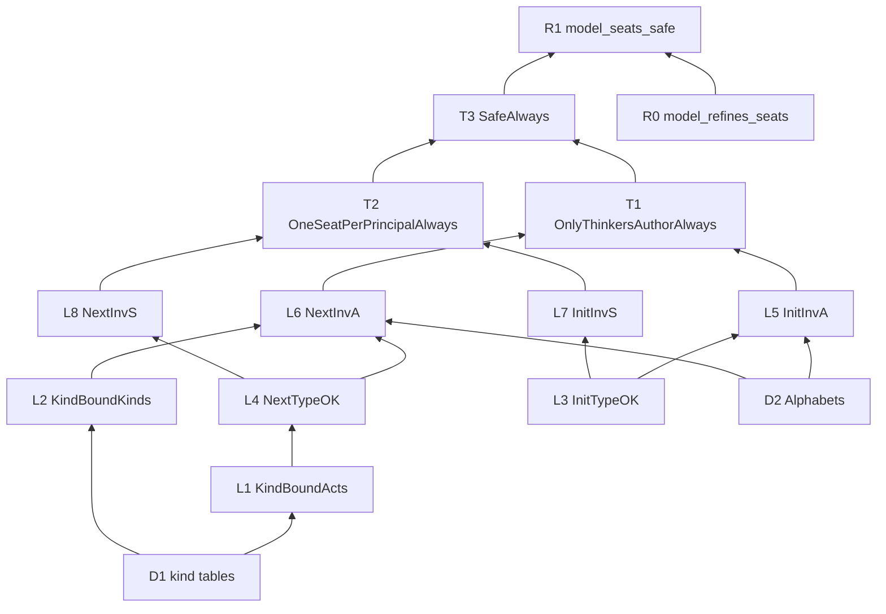

# TOPAK — A blueprint-style layer for one proof module: `Seats`

**2026.11.21** · derived · a draft and a reading, not a record · basis: the tree at `ffd02f1` · at the custodian's
request, after the question of whether the blueprint method of the Liquid Tensor Experiment resembles the premise
lattice. It does not: the lattice says what a proved property *assumes*; a blueprint says how the proof *goes*. This
note drafts the second for one module, as a trial of the form.

**What was read.** `spec/Seats.tla`, `spec/Seats_proof.tla`, `spec/lean/TopakSpec/Seats.lean`, the header and the
theorem list of `mechanism/lean/Topak/SeatsModel.lean`, the two `Seats` rows and the derived premises of
`spec/theorem-premise-binding.md`, ADR-0037 §1, §4 and §9, and the results files named in §6. **What was run.**
Nothing was proved or checked again. The digests the results files print for `Seats.tla`, `Seats_proof.tla`,
`Seats.lean`, `Mirror/Seats.lean` and `SeatsModel.lean` were compared with the tree and agree, and every
declaration named below was found by name in the file cited.

**How to read a node.** Each has a label, a statement in words, the argument in words, what it uses, and the
declaration that carries it in each prover, with the line at `ffd02f1`. `Seats_proof.tla` is written `P`,
`Seats.lean` is written `L`.

## 1. What is being proved, in words

Seats are slots with a kind: thinker, observer or grant. A principal is granted a lease on a free seat, acts under
it, and the round ends. Two things must never happen (ADR-0037 §9):

- **T1, `OnlyThinkersAuthor` (§4).** No authoring act is ever recorded under a seat that is not a thinker's, and no
  vote is ever recorded under a thinker's seat.
- **T2, `OneSeatPerPrincipal` (§1).** No principal ever holds live leases on two seats at once.

Each holds unless the one mutation aimed at it is switched on: `M_KIND` for T1, `M_SEAT` for T2.

## 2. The dependency graph

L3, L4 and L1 exist only on the TLAPS side: Lean's types carry them. R0 and R1 are in `mechanism/lean/`, outside
the module, and are drawn because they are what the module's theorems are used for.

## 3. Definitions

**D1. The kind tables.** `KindOf` gives seat `s1` to a thinker, `s2` to an observer, `s3` to a grant seat.
`KindBound` gives a thinker `Read`, `Draft`, `Emit` and the other two kinds `Read`, `Emit`, `Vote`. Authoring is
`Draft` alone. `Seats.tla` lines 24 to 35; `L` 36 to 54.

**D2. `Alphabets`.** Every live lease's alphabet is exactly its seat's kind bound. This is the strengthening T1
needs and is not in `Seats.tla`: it is introduced by the proof. `P` 61; `L` 140.

**D3. `InvA` and `InvS`.** `InvA` is `TypeOK`, `Alphabets` and T1's property together; `InvS` is `TypeOK` and T2's
property. `P` 62, 110. In Lean `InvA` drops `TypeOK` (`L` 143) and `InvS` is the property itself.

## 4. Lemmas and theorems

**L1. `KindBoundActs`.** Every kind bound is a set of acts. *Proof.* Three seats, three finite tables; by
unfolding. *Uses* D1. `P` 26. No Lean counterpart: `KindBound : Kind → PSet Act` says it in its type.

**L2. `KindBoundKinds`.** If an act is in a seat's kind bound, then it is authoring only if the seat is a thinker's,
and it is `Vote` only if the seat is not. *Proof.* By cases on the three seats and four acts. *Uses* D1. `P` 29;
`L` 135. **This lemma is where the whole of ADR-0037 §4's table enters the proof.** A wrong table fails here and
nowhere else: the Lean mutation check widens the observer bound to include `Draft` and the build fails in this lemma
(`spec/lean/README.md`, *Mutation check*).

**L3. `InitTypeOK`**, **L4. `NextTypeOK`.** The lease table is always a function from seats to well-formed lease
records, under every mutation. *Proof.* Each action writes a well-formed record; a grant's alphabet is within
`Acts` by L1, or is `Acts` under `M_KIND`. *Uses* L1. `P` 38, 41. No Lean counterpart.

**L5. `InitInvA`.** `InvA` holds initially. *Proof.* No lease is live, so `Alphabets` is vacuous; nothing has been
recorded, so T1's property is vacuous. *Uses* L3, D2. `P` 64; `L` 145.

**L6. `NextInvA`.** If the mutation is not `M_KIND`, every step keeps `InvA`. *Proof.* By cases on the action.

- *Grant.* The new lease's alphabet is the kind bound, because the mutation is off; other leases are untouched. So
  `Alphabets` is kept. Nothing is recorded.
- *Act.* The recorded act comes from a live lease's alphabet, which is the kind bound by `Alphabets`, so L2 gives
  both halves of T1's property for the new record. Old records are untouched.
- *EndRound.* One lease stops being live, which can only make `Alphabets` easier.

*Uses* L2, L4, D2. `P` 67; `L` 151. **Why the strengthening is needed.** T1's property alone is not inductive: a
state in which an observer's live lease already contains `Draft` and nothing has been recorded satisfies it, and the
next `Act` breaks it. `Alphabets` rules that state out, and the `Mut # "M_KIND"` hypothesis is used in exactly one
place, the grant case, to keep it.

**T1. `OnlyThinkersAuthorAlways`.** If the mutation is not `M_KIND`, T1's property holds in every reachable state.
*Proof.* L5, L6 and `InvA ⇒` the property, then the invariance rule. *Uses* L5, L6. `P` 96; `L` 185.

**L7. `InitInvS`.** `InvS` holds initially: no lease is live. *Uses* L3. `P` 112; `L` 189.

**L8. `NextInvS`.** If the mutation is not `M_SEAT`, every step keeps `InvS`. *Proof.* By cases on the action.

- *Grant of seat s to p.* The guard says p holds no live lease on another seat. Take two distinct live seats after
  the step. If neither is s, they were live before with the same holders. If one is s, its holder is p and the
  other's holder is not p, by the guard.
- *Act.* Leases do not change.
- *EndRound.* One fewer live lease.

*Uses* L4. `P` 115; `L` 194. Unlike T1, **this property is inductive as it stands**: it needs no strengthening, only
`TypeOK` on the TLAPS side so that the function update can be reasoned about. The hypothesis `Mut # "M_SEAT"` is
used once, to obtain the guard. The Lean mutation check removes the guard and the build fails in this lemma.

**T2. `OneSeatPerPrincipalAlways`.** If the mutation is not `M_SEAT`, T2's property holds in every reachable state.
*Uses* L7, L8. `P` 140; `L` 233.

**T3. `SafeAlways`.** With no mutation, both hold. *Uses* T1, T2. `P` 150; `L` 238.

**M1. `MutKindGrantsAll`**, **M2. `MutSeatIgnoresHolder`.** Not used by any theorem. They say, of the mutated
grant, the one fact that makes each counterexample possible: under `M_KIND` a grant issues every act, and under
`M_SEAT` a grant is not refused for a principal seated elsewhere. `P` 164, 169; `L` 244, 251. The counterexamples
themselves are TLC's. The two statements of M2 differ in form: the TLA+ one says the mutated guard reduces to the
lease update; the Lean one exhibits the step for a principal who holds another seat, which is the more direct
statement of the defect.

**R0. `model_refines_seats`**, **R1. `model_seats_safe`.** A model of the reference's `State::apply`, at the
module's constants and with no issuance changing a seat's kind, reaches only states that map to states `Seats.tla`
reaches with no mutation; so T3 holds of the model. *Uses* T3. `mechanism/lean/Topak/SeatsModel.lean` 1011, 1029.
Its premises are in that file's header and are not repeated here.

## 5. Where the two proofs differ

| | TLAPS (`Seats_proof.tla`) | Lean (`Seats.lean`) |
|---|---|---|
| Object proved about | The frozen module, cited by digest in ADR-0037 | A re-encoding, read against the module and checked against TLC's state graphs |
| Typing | `TypeOK` proved (L1, L3, L4) and carried in both invariants | Carried by the types; three lemmas have no counterpart |
| The invariance rule | `PTL`, discharged by LS4 | `Prelude.invariant` (`Prelude.lean` 95): induction on `Reachable`, checked by the kernel |
| Stuttering | `[Next]_vars`, a case in each step lemma | Dropped: a step that changes nothing keeps an invariant |
| Constants | Fixed in the module: two principals, three seats | Fixed in the types, the same |

The two routes are complementary at one point. The certified TLAPS run leaves three obligations of 110 on LS4,
"whose answer no checker confirms". `Seats_proof.tla` cites `PTL` three times, in the last step of T1, T2 and T3, so
those are the three. They are the steps the Lean route replaces with a kernel-checked induction.

## 6. What the theorems rest on

This is the premise lattice's side, repeated only so that the blueprint can be read alone
(`spec/theorem-premise-binding.md`, the two `Seats` rows and *Derived premises*).

| Premise | Routes | Evidence at `ffd02f1` |
|---|---|---|
| `invariant(Seats)` | T-0045-31, the prover; **or** T-0045-37, Lean, with `enc-faithful(Seats)` | `Seats-proof-results-2026.10.02.txt`: 110 obligations proved. `Seats-proof-cert-results-2026.10.04.txt`: 107 on tlapm's normalization or a checked proof, 3 on LS4. `spec/lean/TopakSpec-results-2026.10.07.txt`: T1 and T3 on `propext` and `Quot.sound`, T2 on `propext`; no choice axiom |
| `enc-faithful(Seats)` | A check | `spec/lean/GraphCheck-results-2026.10.07.txt`: `MATCH` under `none` (6,656 states), `M_KIND` (53,248) and `M_SEAT` (13,824) |
| `refines(Seats)` | T-0045-28; **or** T-0045-37 with `enc-faithful(Seats)` and `model-faithful(apply/Seats)` | R0, R1; `mechanism/lean/SeatsReplay-results-2026.10.06.txt`, a test |
| The mutations and witnesses | T-0045-29, TLC | `Seats-results-2026.09.29.txt`: each mutation breaks its own property and leaves the other holding; three witnesses violated |
| Row premises | T-0045-10 (seat kinds declared); for T1 also T-0045-3 (the floor's B10 and B6) | ADR-0045 Annex A |

Whether these edges are fresh is the specification graph's question (`spec/specification-graph.py check`), not this
note's. The 11.11 feature list reads the `refines(Seats)` route as stale with `mechanism/lean`; that was not
re-examined.

## 7. Statement fidelity: what the module leaves out

A blueprint's other job is to say where the formal statement is narrower than the prose it stands for. Five places,
each read from the module against ADR-0037; none is a finding against the proof.

1. **Authoring is one act.** The module has four acts and `Authoring == {"Draft"}`. ADR-0037 §4's Build column gives
   a thinker `Read`, `Draft`, `Invoke`, `Emit`, `Submit`. `Draft` stands for the authoring variants; that the bound
   discriminates on each of them is the floor's gate (ADR-0037 R5: B10 on `Draft`, `Invoke`, `Submit`,
   `RunInvoke`), not this module's.
2. **`Vote` is unconditional for an observer.** §4 allows an observer `Vote(deny)` only when on the veto roster.
   The module says so in a comment and models neither the roster nor the direction of the vote.
3. **Three kinds.** `operator` (ADR-0037 A4) and `emergency` (ADR-0052) are later kinds and are not in the tables.
4. **T2 is about live leases, §1 about the binding.** §1 says a principal holds exactly one seat, fixed when the
   seat is declared. The module lets a principal be granted `s1`, end the round, and be granted `s2`: T2 forbids two
   seats *at once*, which is what §9 asks the check to show, and is weaker than §1's sentence.
5. **The proof is at the module's constants.** `Seats.tla` has no constant but `Mut`, so the TLAPS theorems and the
   Lean ones are of two principals and three seats, one per kind. The statement at any number of seats and
   principals is `model_inv` in `SeatsModel.lean`, of the model and not of the module.

## 8. On the form

- **What the layer added over the proof module's own comments.** The two remarks in bold under L6 and L8 (why one
  property needs strengthening and the other does not), L2 as the single point where the record's table enters, the
  identification of the three LS4 obligations, and §7. The rest restates what the module's comments already say
  well, and for a module this small that is most of it.
- **What it would need to be kept and not frozen.** A check that every declaration named still exists, and that
  the digests of the three source files are those of the results files cited. Both are what
  `specification-graph.py` already does for its edges, so a kept blueprint is better made a node kind there than a
  second mechanism.
- **Where it would earn more.** The modules whose invariants are long and whose strengthenings are not obvious:
  `Workflow_proof`, `Mesh_proof`, `Outstanding_proof`. For those, the nodes D2 and "why the strengthening is needed"
  are the part a reader cannot recover quickly from the proof text.
