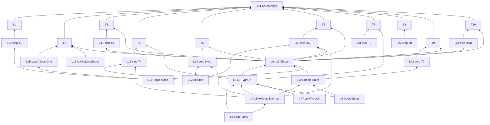

# TOPAK — A blueprint-style layer for a second proof module: `Workflow`

**2026.11.21** · derived · a draft and a reading, not a record · basis: the tree at `0302abe` · at the custodian's
request, after `topak-blueprint-Seats-2026.11.21.md`, whose closing section named `Workflow_proof` as a module where
the form would earn more. It follows that note's conventions and does not revise it.

**What was read.** `spec/Workflow.tla` and `spec/Workflow_proof.tla` in full; `spec/Workflow-rows.txt`; the headers
and totals of the three results files named in §7; ADR-0054 §5, §7, §8 and §12 and its open obligations; the header
of `spec/Workflow_A1.tla`. **What was not read.** `Workflow_A1_proof.tla`, the mechanism's workflow code, and the
rest of ADR-0054. **What was run.** Nothing was proved or checked again. The digests ADR-0054 §12 cites for the two
modules and the three results files were compared with the tree and agree, and every declaration named below was
found by name at the line given.

**How to read a node.** A statement in words, the argument in words, what it uses, and its line in
`Workflow_proof.tla`, written `P`. Lines in `Workflow.tla` are written `W`. The module has no Lean encoding.

## 1. What is being proved, in words

A workflow is a small fixed graph of four nodes. Node `s` is the one decision point: the orchestrator *chooses*
edge `e1` to `b` or edge `e2` to `c`, and `c` is the one outward node. Edges `e3` and `e4` into the sink `j` are
*computed*: they fire by themselves when enabled. A chosen edge is taken by a route that is **decided** by one
replica and later **applied** at its log position, and other entries can be ordered between the two. Workers and
the orchestrator are havoc. Ten things must never happen (ADR-0054 §12); each theorem holds unless a mutation aimed
at it is on.

| | Property | In words | Fails only under |
|---|---|---|---|
| T1 | `AppliedRouteEnabled` | Every applied route passed the full check in the state it was applied in | `M_DECIDEONLY`, `M_NOCONSUME` |
| T2 | `OneRoutePerDecision` | At most one route is ever applied | `M_DECIDEONLY`, `M_NOCONSUME` |
| T3 | `FindingPrecedesNoRoute` | No route is applied after a finding against its source or an ancestor | `M_DECIDEONLY` |
| T4 | `ChosenOnlyByRoute` | A chosen edge's target is activated only by an applied route | `M_DEFAULT` |
| T5 | `EdgeAfterCoverage` | No node is activated from a source whose round was not read to its seal | `M_UNCOVERED` |
| T6 | `TaintedNeverOutward` | The outward node is never activated from a source labelled untrusted | `M_NOTAINT` |
| T7 | `GrantUnderPromotion` | Every grant was made under the promotion's rules epoch | `M_GRANTANYEPOCH` |
| T8 | `PromotedAlternates` | A promoted seating passed the lineage gate | `M_NOLINEAGE` |
| T9 | `CompletedOnlyBySink` | A completed workflow's sink has ended | `M_TIMEOUTDONE` |
| T10 | `BasisStable` | What a route was decided on is what holds when it is applied | `M_REWRITE` |

T11, `SafeAlways`, is the ten together with no mutation (`P` 1230).

## 2. The one idea in the proof

A route in flight is a claim made at decide and cashed at apply. For each fact the route was decided on, the proof
asks whether anything ordered in between can take it away.

- **Facts that cannot be taken away are carried.** Coverage is never undone. An ended node's label never changes.
  An ended node's attributes change only by a rewrite. For these the proof adds an invariant over the routes in
  flight (D3 to D5 below) and the property holds *even with the re-check at apply removed*: T5, T6 and T10 do not
  take `M_DECIDEONLY` as a hypothesis, and TLC's `do_rest` row agrees.
- **Facts that can be taken away are re-checked.** A finding, a consumed decision point, a lapsed lease, a fence,
  the workflow ending. Nothing is carried for these. T1, T2 and T3 rest on the check at apply and fail without it.

That split is ADR-0054 §8's sentence "only subtractive events can make that false between the two", and the proof's
hypotheses are where it can be read off: the properties with `M_DECIDEONLY` in their hypothesis are the ones about
subtractive events.

## 3. The dependency graph

The ten properties are proved separately. No property's proof uses another property: they share only the
infrastructure at the bottom.

## 4. Definitions the proof adds

None of these is in `Workflow.tla`.

**D1. `TypeOK`** (`P` 53). Every variable has its type. The log position and the epoch are natural numbers with no
bound, which is why the proof needs no state constraint where one TLC row does (ADR-0054 §12, `CapLog`).

**D2. `Shape`** (`P` 81). `TypeOK` and four facts that hold under every mutation:

| Conjunct | Says | Needed by |
|---|---|---|
| `BeforePromotion` (`P` 75) | Before the promotion no route is in flight and every node is idle | L10 |
| `PendingEnded` (`P` 77) | The source of a route in flight has ended | T6, T10 |
| `NoFindingNoAt` (`P` 78) | A node with no finding has finding position 0 | T3 |
| `AppliedBound` (`P` 79) | An applied route's position is at or before the log's | T3 |

**D3. `PendingCovered`** (`P` 87). The source of every route in flight is covered. With T5's property it is `InvC`.

**D4. `PendingTrusted`** (`P` 88). No route in flight leads to an outward node from an untrusted source. With T6's
property it is `InvT`.

**D5. `PendingBasis`** (`P` 89). Every route in flight carries, as its basis, the decision node's current
attributes. With T10's property it is `InvB`.

**D6. `AtMostOne`** (`P` 84). The applied set is empty or one element, and is empty until the decision point is
consumed. It stands in for T2's property, which is a cardinality.

## 5. Lemmas and theorems

### Infrastructure

**L1. `EdgeFacts`** (`P` 96). Ten facts about the fixed graph, by unfolding. **This is the only place the graph
enters the proof.** Three of the facts are not bookkeeping and are named where they are used: every chosen edge
leaves `s`; every computed edge enters `j`; no chosen edge enters `j`.

**L4, L5. `ActivateShape`, `ActivateTypes`** (`P` 116, 145). What activating an edge's target does: it writes the
target's four fields once if the target is idle, and otherwise nothing; other nodes are untouched; an ended node
stays ended. L5 repeats the typing part alone because the larger lemma was too big a match for the checked SMT
route (the comment at `P` 138).

**L6. `DefaultEdge`** (`P` 154). The edge `M_DEFAULT` chooses is a chosen edge and is enabled. It lets T5 and T6
hold under `M_DEFAULT`: a default edge is still an enabled one.

**L2, L3, L7, L8. Typing** (`P` 109, 112, 159, 204). `TypeOK` holds initially and is kept by every action.

**L10. `EndedFrozen`** (`P` 276). An ended node stays ended. *Proof.* By cases on the action. *Uses* L1, L4, L6,
`BeforePromotion`. **Why `BeforePromotion` is needed.** `Promote` writes `s` to ready without looking at it. If `s`
could have ended before the promotion, the promotion would un-end it. `BeforePromotion` says an ended node implies
the promotion has happened, and `Promote` is then disabled.

**L11. `AppliedStep`** (`P` 341). Every action but `Apply` leaves the applied set alone, and the log position never
decreases. **L12. `ActStep`** (`P` 367). Every action but `Apply`, `Fire` and `DecisionLapse` leaves the activation
record alone. These two cut each property's case analysis from fifteen actions to the one, two or three that matter.

**L9, L13. `InitShape`, `NextShape`** (`P` 272, 386). `Shape` holds initially and is kept. *Uses* L8, L10, L11.
`PendingEnded` is kept because of L10; `AppliedBound` because a new applied route takes the next position.

### The properties that rest on the check at apply

**T1. `AppliedRouteEnabledAlways`** (`P` 540; step L14, `P` 516). *Proof.* Only `Apply` adds an applied route (L11),
and it records whether the full check passed. With the re-check present the route is added only if the check at
apply passed. *Hypotheses.* `M_DECIDEONLY` adds a route without the check. `M_NOCONSUME` is subtler: the check at
apply then omits consumption, but the recorded verdict is the full check, so a passed check at apply no longer
implies a true verdict. **Inductive as it stands**: it needs neither `Shape` nor `TypeOK`.

**T2. `OneRoutePerDecisionAlways`** (`P` 615; step L15, `P` 550; L16, `P` 605). *Proof.* Carry D6. A route is applied
only if the decision point is unconsumed, so the applied set was empty and becomes one element, and the decision
point is consumed in the same step. Consumption is never undone. L16 turns "empty or one element" into the
cardinality bound. *Uses* `TypeOK`, L11. The theorem carries all of `Shape`; only `TypeOK` is used.

**T3. `FindingPrecedesNoRouteAlways`** (`P` 701; step L17, `P` 627). *Proof.* Two actions matter.

- *A finding lands on node n.* Its position is the next log position, which is past every applied route's position
  (`AppliedBound`). Other nodes' finding positions do not move.
- *A route is applied.* The check at apply found no finding against the source or its ancestors, so each of their
  finding positions is 0 (`NoFindingNoAt`).

*Hypothesis.* `M_DECIDEONLY` alone. **Coverage is not used**, which is ADR-0054 §7's claim that coverage does not
close the race and the re-check does; TLC's `uc_rest` row says the same by experiment.

### The properties carried from decide to apply

**T5. `EdgeAfterCoverageAlways`** (`P` 890; step L19, `P` 776). *Proof.* Carry D3. Coverage is monotone: only `Cover`
writes it, and writes true. A route is decided only on a covered source, so D3 holds of the new route and keeps
holding. At apply the source is covered by D3, whether or not the check runs again. A computed edge and a default
edge fire only when enabled, hence covered. *Hypothesis.* `M_UNCOVERED`, used at decide and at fire. Of `Shape`
only `TypeOK` is used.

**T6. `TaintedNeverOutwardAlways`** (`P` 1031; step L20, `P` 902). *Proof.* Carry D4. A route to the outward node is
decided only when its source's label is not untrusted. Between decide and apply the label cannot change: `End`
writes a node's label but needs the node running, and a route's source has ended (`PendingEnded`); `Rewrite`
changes the status attribute and leaves the label. So at apply the label is still trusted. A computed edge never
enters the outward node (L1), so `Fire` cannot break the property. *Hypothesis.* `M_NOTAINT`, at decide.
**Holds under `M_REWRITE`** for the reason just given, and the proof says so by not assuming it away.

**T10. `BasisStableAlways`** (`P` 1218; step L24, `P` 1152). *Proof.* Carry D5. A route's basis is the decision
node's attributes at decide. Every chosen edge leaves `s` (L1), and `s` has ended while a route is in flight
(`PendingEnded`), so `End` cannot write it. Only a rewrite could. *Hypothesis.* `M_REWRITE`.

### The properties that are one guard

**T4. `ChosenOnlyByRouteAlways`** (`P` 766; step L18, `P` 711). *Proof.* By L12 three actions matter. `Apply`
activates as a route. `Fire` activates a computed edge's target, which is `j`, and no chosen edge enters `j` (L1).
`DecisionLapse` activates nothing unless `M_DEFAULT`. *Uses* `TypeOK`, L1, L4, L12.

**T7. `GrantUnderPromotionAlways`** (`P` 1077; step L21, `P` 1043). Only `Grant` writes the grant epoch, and writes
the current epoch only when it is the promotion's. *Uses* `TypeOK`.

**T8. `PromotedAlternatesAlways`** (`P` 1108; step L22, `P` 1087). Only `Promote` writes the two variables, and its
guard is the property. **Inductive as it stands.**

**T9. `CompletedOnlyBySinkAlways`** (`P` 1142; step L23, `P` 1118). Only `Settle` writes the workflow's state, and
it completes only on an ended sink; the sink then stays ended by L10. *Uses* `Shape` for L10.

### The mutation lemmas

**M1 to M9** (`P` 1260 to 1308). One per mutation, stating the guard the mutation removes. None is used by a
theorem. Five of the nine are proved from hypotheses that already contain the conclusion:
`MutDecideOnlySkipsTheRecheck`, `MutGrantAnyEpochSkipsTheFence` and `MutNoLineagePassesTheGate` conclude a
disjunction whose first disjunct is the assumption, and `MutDefaultTakesAnEdge` and `MutRewriteAdmitsARewrite`
conclude the conjunction of their assumptions. They are true and they document where the mutation acts, as the
module's comment says; they are not evidence that a mutation breaks anything. That evidence is TLC's nine "breaks"
rows.

## 6. Statement fidelity: where the module is narrower than the record

Read from the module against ADR-0054 §5, §7 and §8. None is a finding against the proof.

1. **T6 is proved of "an edge reads its source", not of what a guard reads.** §5 disables an outward edge "when any
   attribute its guard reads is labelled `untrusted`". The only edge into the outward node is `e2`, whose guard is
   `TRUE` (`W` 153) and reads nothing. `TaintOK` (`W` 159) keys on the source's label whatever the guard reads, and
   the module says so: "Every guard here reads the attributes of its source." The rule checked is therefore
   stricter than §5's sentence for this edge, and §5's own case, a guard that reads some attributes and not others,
   is not in the model.
2. **No computed edge enters an outward node.** T6's `Fire` case is closed by the graph, not by the routing rule. The
   rule on a computed outward edge is not exercised by the proof or by TLC.
3. **One decision point.** `PendingBasis` names `"s"` literally, and `AtMostOne` counts every applied route. The
   module's header lists more than one decision point as not modelled; these are the two places a second one would
   change the proof.
4. **T4 depends on the graph's shape.** It holds because no node is the target of both a chosen and a computed
   edge. On a graph where one is, the property as stated is false for an honest mechanism.
5. **The basis is the attributes, not a log index.** §8 says a route carries "the log index of the attribute state
   the orchestrator was shown". The module carries the decision node's attribute record itself, and T10 compares
   the whole record, status and label.
6. **Nine of the ten properties are stated over ghost variables.** `applied`, `findingAt`, `activatedBy`,
   `uncoveredAct`, `routedOnTaint`, `grantEpoch` and `seatOK` are written by the actions to record what happened;
   only T9 reads none. Each theorem is therefore as good as the reading that its ghost is written where the event
   happens: in `Activate` (`W` 186), `Apply` (`W` 255), `Grant` (`W` 205), `Promote` (`W` 197) and `Finding`
   (`W` 239). T8 is the limiting case: the seating is not kept after the gate, so the theorem says the gate ran.
7. **Two of §8's sentences are behaviour, not properties.** "After a void the decision point stays open" is the void
   branch of `Apply` and is stated by no invariant. "A Byzantine orchestrator can stall a workflow and cannot
   misroute it" is the ten properties for the second half; the first half is a liveness matter and the module checks
   no liveness and no deadlock. `Workflow_A1.tla`'s header records a stuck state found there on 2026.11.20, and
   changes `Settle`. This blueprint is of the frozen module; what A1 changes in T9's argument was not read.

## 7. What the theorems rest on

| | Evidence at `0302abe` |
|---|---|
| The record | ADR-0054, **Proposed**. §12's TLC and TLAPS items are marked met (R2, R7) |
| The binding | **No rows.** `spec/theorem-premise-binding.md` does not name `Workflow`; ADR-0054 lists the rows as an open obligation. The premise lattice has nothing to say about these ten theorems yet |
| TLC | `Workflow-results-2026.10.08.txt` (`95b998f616da1875`): 33 rows; the ten hold together over 106,199 states; each mutation breaks its own property and no other |
| TLAPS | `Workflow-proof-results-2026.11.11.txt` (`34a18728d0e92e79`): 1,136 obligations proved, no assumptions |
| Certified | `Workflow-proof-cert-results-2026.11.11.txt` (`a961be0445200e94`): 748 by the prover's normalization, 377 by SMT with a proof ethos accepted, 11 by LS4, uncertified |

The proof cites `PTL` eleven times, once in the last step of each of T1 to T11, so those are the eleven LS4
obligations. For `Seats` the Lean route replaces those steps with a kernel-checked induction. `Workflow` has no
Lean encoding, so here they have no second route.

## 8. On the form, the second time

- **It earned more here, as predicted.** §2 is not written down in one place in the module or the record: the proof's
  header gives the three carried invariants and §8 gives the principle, and the link between the hypotheses and
  the subtractive events has to be assembled. The table under D2 (which conjunct of `Shape` serves which theorem)
  and the two "why" notes at L10 and T1 are likewise recoverable only by reading the case analyses.
- **The graph is flat.** Ten theorems share infrastructure and none uses another. A blueprint's graph is most use
  when it is deep; here the table in §1 and the split in §2 carry more than the picture.
- **The fidelity section found more than it did for `Seats`.** Items 1, 2 and 4 are consequences of the fixed graph
  that a reader of the theorem names alone would not expect. Item 1 is the one worth a second look before the
  binding's rows are written, since a row would say what T6 assumes.
- **Lemma-level argument was left out on purpose.** 1,136 obligations are mostly unchanged-variable bookkeeping.
  The blueprint names the two or three actions that matter per property and says nothing of the other twelve.
