# Diagrams

Diagrams of the corpus and the generators that draw them. A diagram is a derived artifact: it describes the
records and never decides anything. **Where a diagram and a record disagree, the record wins**, and the state of
record is the latest checkpoint.

[](topak/A1-roles-map-2026.10.05.svg)

## CI, releases and the Pages site

Three workflows, adapted from gov-tla's, which adapted them from riemann-diagrams':

- **`diagrams.yml`** runs on every pull request and push to `main`. It regenerates the family under Python 3.9
  and fails on any `WARNING`, `ERROR` or `NOTE` line, on a read that fails, and on any difference from the
  committed SVGs and manifest. It also fails on any link `check-links.py` rejects (§ Links). The script is fetched
  from riemann-diagrams at a pinned commit and checked by its sha256. Many diagrams read results files, records and specs at build time, so a change elsewhere in the corpus
  that a diagram reads fails this check until the diagram is amended. A diagram whose files have moved on since it
  was drawn reads them with git at a pin in [`topak/src/lib.py`](topak/src/lib.py) instead: B11 and H9 read theirs
  at `PIN_G12`, the merge of PR #86 (2026.11.17), and moving a pin is an amendment of those diagrams.
- **`release.yml`** runs when the custodian pushes an annotated `diagrams-vMAJOR.MINOR.PATCH` tag on `main`. The
  prefix keeps it apart from the corpus's own tags (`G<n>`, `REF-`, `ToO-rev`, `glossary-`). It runs
  `diagrams.yml` on the tag, then creates a GitHub release. The release holds the SVGs and `pins.json`, which
  records the tag, the pins, the generator's commit and the run. It also holds `SHA256SUMS` over all of them, and
  notes that open with the tag's message. Then it calls `pages.yml`.
- **`pages.yml`** publishes one release to GitHub Pages. It checks the tag's SVGs against the release's
  `SHA256SUMS` before it deploys, so the site is the release and nothing else. It serves the SVGs at
  `diagrams/topak/…`, the paths they have in the tree, and an index: this README, rendered, above the list of
  diagrams. It ends by reading `pins.json` back from the site, and fails unless the site names the tag. Run it by
  hand from `main` with an existing tag to republish a release.

To release, tag `main` and push the tag. The message says what changed and which diagrams a reader must re-read:

```bash
git tag -s diagrams-v0.1.0 -m "diagrams-v0.1.0: …" && git push origin diagrams-v0.1.0
```

The site, <https://scottcochran.github.io/TOPAK/>, holds one release at a time; every release stays on its release
page. Diagrams opened from the site are served as `image/svg+xml`, so they follow the reader's light or dark
setting there. `g1-to-bootstrap-2026.09.18.svg` is not part of the family, the check or the releases: its generator
writes outside the tree.

## Links

The diagrams link to each other and to the sources they draw, following the `linking-posters` method of
riemann-diagrams' proof-posters plugin (`plugins/proof-posters/skills/linking-posters/`), as gov-tla's do. Open a
diagram in a browser to follow them: from the Pages site, a release's assets or the file. **GitHub's file viewer
shows an SVG as an image, without its links or its style.** No text is added for a link, and nothing moves: every
line breaks where it did and every shape is where it was, so a renderer that runs no CSS shows the diagram as
before.

**What a link opens.** Names and references are linked, not prose.

| In a diagram's text | Opens |
|---|---|
| A record, `ADR-0069` | the diagram that draws that record in full (B11, which lists it in `RECORDS`), at its top; on that diagram, or for a record no diagram draws, the record at the pin |
| A part of a record: `ADR-0033 §2`, `A19`, `E1`, `R4`, `Annex A`, `finding 9` | its heading, History row or line in the record at the pin |
| A list of parts: `ADR-0033 §1–§3, §7 finding 9, A7, A10–A12` | each part, in the record named first |
| A section with no record named before it, on a diagram that draws one record | that section of the diagram's record (`§10.2` on B11 is ADR-0069 §10.2) |
| A checkpoint's part: `G12 §9`, `G12 item 113`, `G10 items 87, 88` | its heading or table row in the checkpoint document at the pin |
| `Genesis Checkpoint G12`, `G12 (2026.11.16)` | the checkpoint document |
| `ToO rev 16 §2.3`; `ToO §3.2` | that section of the Theory of Operation at the revision's tag; unversioned, at the revision the diagram's footer names |
| A trusted-base row `T-0045-31`; a deployment row `D-0024-2` | its row on G1; its card on G2 (else on its record's diagram); else its row in the record |
| A TLA+ module with a diagram of its own, `Seats.tla` or `spec/Seats.tla`; its proof module, `Seats_proof.tla` | that module's diagram (I1), at its top; for the proof module, at its theorems (`#theorems`); on the module's own diagram, the file at the pin |
| A path or file name, in code or in running text (`tools/ci-plan.sh`, `Coupling.tla`, `spec/`) | the file or directory at the pin; a file name only when one tracked file has it. A Markdown file then takes the sections after it (`proof-certification.md §2`) |
| A code-font name a card or row of this diagram is titled with | that card or row |
| A distinctive code-font name (`clearSet`, `KUp`, `M_KIND`, `topak-floor`) | the one other diagram that anchors it, else its definition, when one module under `spec/` defines it |
| A commit (`36269bc`), `PR #68`, `pull request #68` | the commit, when the pin's history holds it; the pull request, when it was merged before the pin |
| A diagram's header label (`TOPAK · B11`) | its row in this README's table at the pin |
| A count in a title (C2's nine variants, C3's twelve fields, E3's five folds, G1's thirty-seven rows, B3's and B8's three stages) | the list it counts |

A single word in code (`seat`, `Read`, `input`, `latest`) links only to an anchor on its own diagram: the same word
means different things on different diagrams, and in different modules. A short id (`B10`, `R5`, `G9`) never
crosses diagrams, since it may be a boundary, a rule, a gate or a diagram, and a bare `Gn` is a checkpoint only
where the text says so (`G12 §…`, `G12 item …`, `Genesis Checkpoint G12`, `G12 (date)`).

**Anchors.** Every diagram's header is `#top`. A card or table row whose title or first cell leads with a source's
own key takes that key as its id: a record (`H2-adr-map-2026.10.05.svg#ADR-0057`), a row
(`G1-trusted-base-2026.10.05.svg#T-0045-31`), or one code-font name (`#RulesFloorBase.tla`, `#Read` for
`` `Read(ref)` ``). Where a key is drawn twice, the first drawn keeps it. A few lists are anchored by name: G1's
`#annex-a` and `#annex-b`, C2's `#matrix` and `#policies`, C3's `#schema`, E3's `#folds`, B3's `#stages`. The ids are
the sources' own names, so a link stays good when a layout changes.

**The pins.** Every link out opens `github.com/scottcochran/TOPAK/blob/<commit>/…` at a commit, never a branch:
`PIN_LINKS` in [`topak/src/lib.py`](topak/src/lib.py) (`ffd02f1`, main on 2026.11.20), or `PIN_G12` for B11 and
H9, which read their files there; the Theory of Operation at its revision's tag (`PIN_TOO_REV14` to `16`). Lines are
found in the file at that commit with git ([`topak/src/sources.py`](topak/src/sources.py)), not in the tree, so a link
lands on the line it was made for after the file moves on. A heading of a Markdown file is opened in the rendered
file, at the anchor GitHub gives it (`…G12-2026.11.16.md#22-the-policy-floor`), so a section is read as the record
shows it. The rendered file anchors headings only, so a History row, a table row, an item or a finding is opened as
plain text at its line (`?plain=1#L…`), which GitHub highlights. A wrong anchor would open the top of the file and
fail no check, so [`check-heading-anchors.py`](check-heading-anchors.py) compares every linked heading with
GitHub's rendered page at the pin; it needs the network, and is run by hand after a pin moves. A file with a heading
whose anchor cannot be told from its source (a link, HTML or emphasis in it) keeps plain lines throughout; none
has one today. Commits and merged pull requests are opened at their own pages, which do
not move. Moving `PIN_LINKS` regenerates every diagram; it changes links, not drawings.

**The manifest and the second run.** [`topak/manifest.json`](topak/manifest.json) lists every diagram's anchors,
the records it draws in full and its links by kind. A diagram links to another's anchor only when the committed
manifest lists it. When a run moves any diagram's anchors or records, the generator updates the manifest, prints a
`NOTE` line and exits 1. Run it again, and the links follow.

**Module diagrams (I).** A diagram of family I draws one TLA+ module, and its names mean what that module says
(gov-tla's rule). On it, a code-font name its module or proof module declares or defines opens that line, even a
name other modules also define (`Spec`, `Grant`, `lease`): the diagram's `MODULE_FILES`. The names it anchors are
never the target of another diagram's text, so a module page takes no link away from the diagram that anchored a
name before it (`lib.LOCAL_FAMILIES`). Every other diagram's mention of a drawn module's file name opens its diagram (the Links table, above): the generator writes each module diagram's `MODULE_FILES` into the manifest as `module`, and `lib.MODULE_HOME` reads them back.

**Where you land.** The target is framed when it opens: a card, a list or a header shows a halo, and a row is
recoloured amber. The frame pulses three times and then stays; under `prefers-reduced-motion` it does not pulse.
Seen in Chrome. Untested in Firefox and Safari.

```bash
# Every link lands: parse every output, no duplicate id, every target exists and is framed, every link out pinned
uv run --no-project --python 3.12 python <riemann-diagrams>/plugins/proof-posters/skills/linking-posters/scripts/check-links.py \
  --config diagrams/proof-posters.toml
```

The generator makes the same checks and prints a `WARNING` for any failure, so CI fails on a link that lands
nowhere. At 2026.11.26, with I1 to I14, the family carries 23,050 links: 4,240 within a diagram, 3,310 to another
diagram's anchor, 15,432 to a source at its pin and 68 to a commit or pull request, over 2,286 anchors (counted by
`check-links.py` and from the manifest; the manifest has the current figures).

## The TOPAK diagram family (2026.10.05)

Forty-two diagrams covering the pattern's logical hierarchies and domain boundaries, drawn against Genesis
Checkpoint G10 (2026.10.05) and Theory of Operation revision 14. Each diagram is an SVG that adapts to light and
dark themes (`prefers-color-scheme`; renderers without CSS fall back to light). In the light theme the cards sit on a grey
page matched to the content's mean luminance, as in gov-tla and riemann-diagrams ([PAGE.md](PAGE.md)). The diagrams are sized for
reading zoomed in and print at poster scale. Where a record has a table, the diagram draws all of it.

**Revised 2026.10.05** against G10 and ToO rev 14. Every diagram of the 2026.10.03 family is redrawn to Batches 27
to 35, and seven are new: the floor in force and its three gated stages (B8), labels and handles (C6), the tool
list and the allowlist entry (C7), the operator as a principal (C8), break-glass as an emergency seating (D5), the
correlator's folds (E3) and proof certification (H6). Two statuses are new to the family's language:
**provisional** (ADR-0029 A4; ADR-0050, ADR-0052 and the amendments that rest on them), drawn as a dashed blue
pill, and **genesis-provisional** (ADR-0030 A3; the policy floor), drawn as a dashed violet one. X1 is drawn
retired wherever it appeared, R8 withdrawn, and the unsigned operator socket is marked BOOTSTRAP. G3 opens with
the binding table's gap (G10 item 90): seven of the twenty-two proof modules have no row.

**Amended 2026.10.06** for ADR-0053 (**Proposed**, drafted after G10): the Lean route. One diagram is new, H7, and
ten are amended, each where the Lean results bear on what it draws: B3 (the genesis floor's totality under Cedar's
model), D2 (the composition proved of `admit.rs`), E2 (the clock check and `Coupling`), G1 (the proposed row
T-0045-37, drawn apart from the thirty-six), G3 (what the binding table would gain, and why no premise moves), H1
(the three `lean/` directories and the Lean tooling), H2 (ADR-0053), H3 (a Lean lane and a note per module), H5
(the Lean loop beside the TLAPS loop) and H6 (the Lean route beside certification). A fourth word joins the three:
**proved in Lean**, of an encoding, a transcription or a statement, never "proved" alone (ADR-0053 §1), and every
Lean statement carries ADR-0053's Proposed status. The files keep the family's date; the other 28 regenerate
byte for byte. Amended again the same day for ADR-0053 R4: H7 and H3 draw the model of `State::apply` that refines
`Seats`, and the replay of the reference's recorded traces through it; and for R5, the second model on it, with
`Coupling`'s properties, and its replay; and for R6, the `Seats` and `FloorComposition` encodings checked against
TLC's state graphs (H7); and for R7, derived premises in the premise table (G3, H7). **ADR-0053 was ratified on
2026.10.06 (Batch 36)**: the twelve diagrams that drew it as Proposed now draw it accepted, G1 counts thirty-seven
Annex A rows with T-0045-37 in the third group, and G3 reads the merged premise binding.

**Amended 2026.10.08** for Batch 37 (ADR-0046 A2, E3 and E4; ADR-0045 A3 and E1; ADR-0053 E1): four diagrams. G1 and
H6 draw T-0045-31's rows as amended: its residual names two known unsound cases in the prover's translation, and its
instance notes that build 7824dab has both and that no result a record cites rests on either. H6 and H3 count all
five of `RulesFloorNV_rev5`'s Zenon scripts refused by Isabelle, where tlapm reports one; H6 reads the refusals from
the newest scan results file, now `spec/proof-scan-results-2026.10.08.txt`. G3 reads the premise routes renewed with
ADR-0045's pin (`premise-routes-results-2026.10.08b.txt`). Regenerated, H3 also counts the Lean theorems of
`TopakSpec-results-2026.10.07.txt` (136 with their axioms printed). H7 is left as drawn at Batch 36: regenerated, it
would draw the Lean results of 2026.10.07 without `Emergency`'s graph check, which has a series of its own that H7's
generator does not read yet, and it is owed with the liveness work at the next cut. The other 34 regenerate byte for
byte.

**Amended 2026.10.09** against Genesis Checkpoint G11 (2026.10.09) and ToO rev 15: three diagrams are new and
seventeen are amended. The new ones are the Proposed workflow records and the liveness work: **C9**, a workflow
as a promoted DAG (ADR-0054, Proposed); **D6**, a workflow as a mesh with the mechanism as its bus (ADR-0055,
Proposed); and **E4**, stalls that end, liveness checked by TLC and not proved. The amended diagrams are A1, A4,
B7, B8, C1, C2, D1, E2, G1, G2, G3, H1, H2, H3, H4, H6 and H7. They draw G11's counts:
- twenty-four proof modules, 5,416 obligations and twenty-one certified;
- thirty-one TLA+ modules and 155 tests;
- the `workflow` floor stage, Proposed, which the reference links and which is not in force;
- REF-2026.10.08 and REF-2026.10.09, pending;
- ADR-0053 as C4 for `refines(Seats)`, and twenty-nine records that require confirmation.

`Workflow` and `Mesh` are drawn as checked and not proved, `Coupling_live`'s leads-to properties as checked and not
proved, and `mechanism/lean` as stale (G11 item 103). The words stay distinct: *proved*, *proved in Lean*,
*certified* and *checked*. H7 now reads `Emergency`'s graph-check series, owed since 2026.10.08. An amended diagram
says so in its footer and names its state of record. The three new diagrams name G11 as theirs. The other
twenty-two regenerate byte for byte.

**Drawn 2026.11.06** for ADR-0056 (**Proposed**, drafted 2026.11.06, after G11 and Batches 38 and 39): one new
diagram, **C10**, a call's user scope. It draws the record whole: §1's four questions and four owners, a round that
acts for a user from the subject's provider to the downstream system, the three points that close the confused
deputy and the degeneracy that reopens each, the entry's `credential` part with W11–W13, `R10` and `R11`, the
trusted base's three rows (T-0045-38 and T-0045-39 new, T-0045-25 widened), the options, the findings and the
ratification condition. Nothing on it is in force or built. No other diagram is amended: C7, D1, B8 and G1 take
ADR-0056's entries when it is ratified, and H2 adds the record at the next amendment of the map.

**Drawn 2026.11.10** for the command-chain overlay, ADR-0059 to ADR-0068 (**Proposed**, drafted 2026.11.10, and
ADR-0059 to ADR-0067 revised R1 the same day to take the findings of their TLA+ modules): nine new diagrams. **A5**
is the overlay at a glance; **B9** planes, charters and replicas (ADR-0059, ADR-0061); **B10** the rules of
engagement and the `federation` floor stage (ADR-0067); **C11** the release seat (ADR-0066); **D7** the intent
boundary, the governor and the lease (ADR-0060, ADR-0062); **D8** peer topics (ADR-0065); **E5** revocation bounded
in effects and the plane's ticks (ADR-0063, ADR-0064); **G4** the overlay's adversaries, trusted-base rows and
assumptions (ADR-0068); and **H8** the evidence of the eight modules. Every record is drawn Proposed and as an
overlay, not the archetype. The modules are drawn as checked (TLC, at small constants) and proved (TLAPS), and each
proof as certified only with its LS4 steps named. The `federation` stage is drawn not written and the reference not
built. Where a diagram adds a cross-reference the records do not make, such as a module property beside a floor
entry (B10) or an adversary (G4), the column says it is the diagram's. ADR-0068 has no R1, so G4 draws its "no
module is written" beside the modules that exist. H8 reads its counts and digests from `spec/` at build time. No
other diagram is amended: H2 stops at ADR-0055, and G1, G3 and H6 are left as drawn although their inputs have
moved. G1 and G3 would take Batch 39's text, and H6 would read the overlay's scan as the newest
`proof-scan-results` file.

**Amended 2026.11.17** against Genesis Checkpoint G12 (2026.11.16), Batch 40 (2026.11.17) and ToO rev 16, for G12 item
76 (the diagrams behind the checkpoint): six diagrams are new and fifteen are amended. The new ones draw the records G12
names as undrawn, every one **Proposed** and nothing of them built: **A6**, the lifecycle secured at its boundaries
(ADR-0070); **B11**, the Build-Run pipeline (ADR-0069), with an "as built" band that compares the record's cited digests
with the tree at build time; **D9**, the archive of record, its retention schedule and its two stores (ADR-0074 to
ADR-0076); **H9**, the specification graph and a deployment's declaration against it (ADR-0057, ADR-0058), reading
`spec/specification-graph.json` and the 2026.11.07 results file at build time; **H10**, user documentation as a derived
layer, the service and the reader (ADR-0071 to ADR-0073); and **H11**, TLA+ checks in the tla-kit image (ADR-0077). The
amended diagrams are A1, A4, B7, C9, D6, E4, G1, G3, H1, H2, H3, H4, H6, H7 and H8's siblings' counts: `Workflow` and
`Mesh` are drawn **proved** and certified (ADR-0054 R7, ADR-0055 R3; 2026.11.11), still under Proposed records; Batch 39
is drawn (G1, G3, H6, E4) and Batch 40 (B7, H2, H4, A1): ADR-0033 A19 and A20 ratified, `SHA256SUMS-REF-2026.11.16b` the
measure of the reference, finding 9 closed by `spec/Paxos.tla` (checked, not proved; trace-validated through
`PaxosTrace.tla`); the counts are G12's: thirty-four proof modules, 13,622 obligations, thirty-one certified, forty-one
TLA+ modules, 159 tests, eighteen modules without a binding row; H2 reaches ADR-0077 in five new bands. H6 now reads
`spec/proof-scan-results-2026.10.08.txt` by name: the later scan files answer a different question (the prover's unsound
cases), and reading the newest had drawn their counts as Isabelle's refusals. Each amended diagram says so in its footer
(`AMENDED_G12`); each new one names G12 with Batch 40 as its state (`STATE_G12`). The other 37 regenerate byte for byte
under the pinned interpreter. H9's counts move when the rebuilt graph lands (529 nodes, 495 edges; a separate branch).

**Drawn 2026.11.26: family I, one diagram per TLA+ module**, after gov-tla's B diagrams
(`derived/topak-module-diagrams-scope-2026.11.26.md`). **I1**, `Seats.tla`, is the pilot. It draws the module's machine
from its own definitions, its two properties with the ADR-0037 section each states, the mutation matrix, the
witnesses, all thirteen statements of `Seats_proof.tla`, the certified run's routes, the Lean re-encoding with its
mirror and graph check, the premises the binding names, the model of the code that refines it (ADR-0053), and what of
ADR-0037 §4 the frozen module does not model. Everything is read at build time through `topak/src/modules.py`, which
names each file it reads. The Lean files are the ones ADR-0053 cites (`TopakSpec-results-2026.10.06b.txt`,
`GraphCheck-results-2026.10.06.txt`), compared with the later 2026.10.07 files. Each file is read at `PIN_LINKS` and
must be the same bytes in the tree. Every digest a results file cites is compared with the file, and what the diagram
expects the files to say is held as literals and compared both ways. `Seats-results-2026.09.29.txt` names no digest,
so the build checks only that the module has not changed since the file was committed. It also checks that the graph
check's re-run of TLC has the file's state counts. The page's shared bands are `topak/src/modpage.py`. No other
diagram is amended. The library change (module-local names, `LOCAL_FAMILIES`) leaves the other 58 byte for byte.

**Drawn 2026.11.26, later: I1's picture, and I2 to I6**, the rest of the floor and seats batch. Each opens with a
picture of the module's mechanism (`modpage.flow_picture`), which I1 now has too, and is built from the same bands. I2,
`RunSeats.tla`, checks the alphabet it issues each Run seat against ADR-0043 §2's table. I3, `FloorComposition.tla`,
and I4, `FloorRouting.tla`, share one results file, and both draw ADR-0030 §9's table whole, each row compared with
it. I3 draws a finding: the binding cites ADR-0030 §4 for `BundleCannotWriteFloorInputs`, where §3's text and the
module say §3. I5, `RulesFloorNV_rev5.tla`, keys its matrix by row, since a variant is a dropped entry or the
mechanism without recusal. It draws ADR-0026 §7's table compared row by row, and its proofs as proved and **not
certified**: Isabelle rejected one of Zenon's proofs, obligation 55 (G10 item 74). I6, `RulesFloorBase.tla`, has no TLC
run or proof module of its own. It draws ADR-0026 §2's table against the module's entries, the three copies of the
floor entry by entry, and ADR-0029 §5's modules against the tree (`Genesis`, `RulesFloor` and `Promotion` are not
there). It also draws a finding: its R6 bound and genesis count predate ADR-0026 A2. `RulesFloorNV.tla`, the G1 copy,
is drawn only as I6's third column (scope decision 4).

**Linked 2026.11.26: a drawn module's file name opens its diagram** (scope decision 3). Fourteen diagrams that name one
of the six modules, B2, B4, B7, B8, C1, C2, D4, D5, G1, G3, H3, H5, H7 and H9, now open I1 to I6 where they opened the
module at the pin. That includes H3's module rows: a module's name opens the diagram's top, and its proof module's name
opens its theorems. 121 links move. Their drawings are byte for byte the same once the links are set aside, and no
footer changes, since a link is not a drawing.

**Drawn 2026.11.26, the confinement and leases batch: I7 to I14**, released after `diagrams-v0.2.1`. **I7**,
`Confinement.tla`, and **I8**, `Confinement_A1.tla`, draw mutation by property by rung (`Declared`, 0 to 3), and every
row's verdict is held as a literal. I7 draws ADR-0034 §7's two tables, each compared row by row, and the row neither
carries (`hx0`, finding 6). I8 draws the one definition its successor changed (`Evidence`), with every other one compared
and every check the two runs share. Both are proved and **not certified**: three obligations failed in each certified
run (G10 item 74). **I9**, `ConfinementRefinement.tla`, draws the trace validation (82 traces, 1,007 steps, every one
matching). The generator that writes each trace's module is read to show that every MATCH includes the refinement
invariants. **I10**, `RunConfinement.tla`, draws the results by mutation, property and declaration (`Filtered`,
D-0034-5), against ADR-0034 A2's condition and Met line. **I11**, `Lease.tla`, frozen and without a proof module, and
**I12**, `Lease_A1.tla`, draw ADR-0031 §8's table, each against its own file, and I12 draws the four definitions A1
changed. **I13**, `Labels.tla`, and **I14**, `ToolList.tla`, draw property by mutation beside the header's "must break"
lists, compared. I13 also draws the four rows its proof found. Where a module's results are thin, a page reads its
proof statements' roles from their form (`modpage.form_role`), and says so. Three findings are drawn, each for the
custodian:
1. ADR-0046's Open obligations give the certified results files' digests as the digests of `Confinement_A1_proof.tla`
   and `RunConfinement_proof.tla` (I8, I10).
2. `theorem-premise-binding.md` still marks ADR-0034 A2 pending, though it was ratified in Batch 30 (I10).
3. `Labels.tla` has no binding rows (I13).

`ToolList.tla` has no binding rows either, but ADR-0048 already lists those as owed. Thirteen other diagrams that
name these modules (B3, B8, C3, C4, C6, C7, D1, G1, G2, G3, H3, H5, H9) now open I7 to I14. 92 links move, and no
drawing does. The "where else" check now reads drawn text only, so a link to a module's definition is not a mention.

| Id | Diagram | What it shows |
|---|---|---|
| **A · Orientation** | | |
| A1 | [Roles map](topak/A1-roles-map-2026.10.05.svg) | T, O, P, A, K as roles with obligations; the reference's instruments at G11 (the Lean route, the `workflow` stage, the orchestrator, 155 tests) and what it does not claim |
| A2 | [Two domains, one membrane](topak/A2-two-domains-one-membrane-2026.10.05.svg) | `Build(Contain) → Run(Contain)`: the gate, both alphabets and each domain's ingress (Run's four labelled items, handles, the tool list), the people-only `operator` and `emergency` seats (provisional), and promotion, which now seats, as the only crossing |
| A3 | [Boundary register map](topak/A3-boundary-register-map-2026.10.05.svg) | B1–B14 placed on one system picture; the full register, and what has changed since it was written, restated at G10 |
| A4 | [Orientation and monotonicity](topak/A4-orientation-monotonicity-2026.10.05.svg) | The orientation rule across eighteen layers, Ingress and Operation added at rev 14, and Workflow and the evidence of proof at G11 (two rows on Proposed records), with where it is not yet whole |
| A5 | [The command-chain overlay](topak/A5-command-chain-overlay-2026.10.05.svg) | ADR-0059 to ADR-0068 (Proposed): the tree from the root plane through commanded planes and the intent boundary to the autonomous plane and vehicles, each element tagged by its record; the ten records and their evidence; postures by effect; what each record reports upstream and what the archetype would owe; ADR-0068 §4's ten things given up |
| A6 | [Lifecycle boundaries](topak/A6-lifecycle-boundaries-2026.10.05.svg) | ADR-0070 (Proposed): the six phases with every boundary B1–B29 placed on one, what each declares (sides, what crosses, instant, interval, if unavailable), the common rule, the drills, the owed rows and every ratification item not met |
| **B · Authority** | | |
| B1 | [Authority chain](topak/B1-authority-chain-2026.10.05.svg) | From the intent axiom to an effect, including who puts a lease on the log (a quorum's first lease, operators' signed requests under `C1`–`C9`, BOOTSTRAP), break-glass as an emergency seating, and the audit chain back up |
| B2 | [Verified object and edge](topak/B2-verified-object-and-edge-2026.10.05.svg) | What is proved once, against what may only subtract (B4); the 28 policies of the floor in force (genesis-provisional), one floor exception, X1 retired |
| B3 | [Floor change routing](topak/B3-floor-change-routing-2026.10.05.svg) | The computed route for a floor change, the proof-carrying gate, the three gates, the three-stage build of the floor in force, and every line of its gate run; the genesis floor's totality also proved in Lean under Cedar's model (ADR-0053, B36) |
| B4 | [Rules floor](topak/B4-rules-floor-2026.10.05.svg) | R1–R9 at G10 (R6 and R7 restated, R8 withdrawn), the issued things (a)–(h), parametricity, the non-vacuity runs, the proofs, and the `_A1` successors |
| B5 | [Promotion quorum](topak/B5-promotion-quorum-2026.10.05.svg) | Promotion as a round: gates, seats, recusal, tally, stalls; and since ADR-0024 A3 (provisional) a promotion seats: the first lease on the tally, an operator's successor grants, the first operators at bootstrap; BOOTSTRAP at the reference |
| B6 | [Anchor custody](topak/B6-anchor-custody-2026.10.05.svg) | The havoc issuer and what it issues at G10 (a provider's key, the two lists); the issuer now seats; the custody axis; who is at the gate |
| B7 | [Genesis to bootstrap](topak/B7-genesis-to-bootstrap-2026.10.05.svg) | Ratification to G11, the 29 confirmation-required records (ADR-0053 C4 added; two provisional), the A2.5 line at G11, the trigger and the ceremony with the first operators and floor fitness |
| B8 | [The policy floor in force](topak/B8-floor-stages-2026.10.05.svg) | How `build.py` makes the floor in force from the genesis draft: the `labels`, `control` and `emergency` stages with each one's entries, schema changes, cases, digests and citing records; every gate per stage; the genesis-provisional status, the wrong opening comment, and all 28 policies; and a fourth stage, `workflow` (Proposed, 30 policies, 123 cases), which the reference links and which is not in force |
| B9 | [Planes and charters](topak/B9-planes-and-charters-2026.10.05.svg) | ADR-0059 and ADR-0061 (Proposed): a chain under charters narrowed field by field, the budget debit and R1's capture finding, commit certificates, the plane fence; seven replicas, PBFT's two conditions (recalled), the shrink schedule with R1's one-vote rule and the split vote; `Federation` and `Membership` (five replicas, not seven) |
| B10 | [Rules of engagement and the `federation` stage](topak/B10-federation-floor-stage-2026.10.05.svg) | ADR-0067 (Proposed): standing rules in the one Cedar floor, a mission's rules in a promoted Wasm bundle, judgments nowhere in the admit path; FD1–FD14, none written, with the diagram's own cross-reference to module properties; the two relaxations; "in force" as a precondition no record here meets |
| B11 | [The Build-Run pipeline](topak/B11-build-run-pipeline-2026.10.05.svg) | ADR-0069 (Proposed): intake to rollout keyed by digests, K1–K7, the R1 intake gates and the per-class gates, the return path, the repurposed CI workflows with an "as built" band read from the tree at build time, Annex A and B |
| **C · Principals and the membrane** | | |
| C1 | [Principal, seat, cell](topak/C1-principal-seat-cell-2026.10.05.svg) | Deployment → domain → cell → seat and stage → principal → lease; the five seat kinds, including the people-only `operator` and `emergency` kinds (provisional); seatings; the per-seat declared rung; the orchestrator (Proposed) |
| C2 | [Alphabets by seat](topak/C2-alphabets-by-seat-2026.10.05.svg) | Build's six variants, Run's three and the operator's control alphabet of six against five seat kinds, and the orchestrator's `Route(edge)` (a sixth, Proposed); the floor in force in full; channel fidelity in force |
| C3 | [Lease anatomy](topak/C3-lease-anatomy-2026.10.05.svg) | The twelve fields and what travels beside them (no tool set); who grants and who denies (provisional); the life cycle, the fixed expiry race, and the one-round emergency lease |
| C4 | [Confinement rungs](topak/C4-confinement-rungs-2026.10.05.svg) | Rungs 0–3, P1–P7, verdicts, the four conjuncts of `Contained`; the Run profile in force (P4 as channel fidelity); the proofs, two not certified |
| C5 | [Rung-1 launcher channel](topak/C5-rung1-launcher-channel-2026.10.05.svg) | Launch, appraise, grant, bridge (ADR-0036, Proposed; the launcher built under ADR-0033 A7, ratified ahead of it); a `Regrant` at rung 1 must launch a guest, not built |
| C6 | [Labels and handles](topak/C6-labels-and-handles-2026.10.05.svg) | Run's four labelled items, delivery clear or by handle per seat kind, `clearSet` and the floor's `R5`–`R7` minimum, the R10 join `Labels.tla` found, the stale-`clearSet` refusal, the envelope's label fields, and what the label machinery trusts |
| C7 | [Tool list and allowlist entry](topak/C7-tool-list-and-entry-2026.10.05.svg) | ADR-0049's entry, its load checks W1–W10 and the two issued lists; the tool host reading the target from the entry; the tool list rendered and opening the round; no per-tool lease narrowing; what the reference does not follow |
| C8 | [The operator is a principal](topak/C8-operator-principal-2026.10.05.svg) | ADR-0050 (provisional): the operator seat and its six signed control actions mapped to `C1`–`C9` over thirteen facts; identity provider and key custody; the quorum path (not built) beside the BOOTSTRAP socket; `Operators.tla`; the exit from provisional |
| C9 | [A workflow is a promoted DAG](topak/C9-workflow-dag-2026.10.05.svg) | ADR-0054 (Proposed): a workflow as a promoted graph of seatings; the promotion seats every cell; the mechanism routes on typed attributes; an orchestrator cell may only choose among enabled edges; a route is checked again where it is applied; `Workflow.tla` (checked, not proved); the `workflow` floor stage at the reference (A16, pending, not in force) |
| C10 | [A call's user scope is downstream](topak/C10-user-scope-2026.10.05.svg) | ADR-0056 (Proposed): which user a round acts for is bound by the mechanism from a provider-signed assertion carried with the grant, beside the lease; the policy decides whether a call may use it (`R10`, `R11`; the bundle only narrows); the tool host injects the one credential; the downstream system decides what it permits; the tool decides nothing. The confused deputy closed at three points, D-0056-1 to 3, T-0045-38 and 39, and what ratification needs |
| C11 | [The release seat](topak/C11-release-seat-2026.10.05.svg) | ADR-0066 (Proposed; provisional while ADR-0052 is): one act from a person at a commanded plane, ordered with its certificate, relayed, and fired by the governor's interlock and its six checks (the envelope check not modelled); R1's three corrections; the release seat beside the emergency seat; `Release` |
| **D · Admit path and the record** | | |
| D1 | [Admit pipeline](topak/D1-admit-pipeline-2026.10.05.svg) | Decide, then order, then effect, with a denial lane; an operator's signed request and an emergency activation; the sixteen log-entry kinds (`WorkflowLoad`, `WorkflowGrant` added) and sixteen `Applied` results; what `Mechanism.tla` checks against it |
| D2 | [Policy composition](topak/D2-policy-composition-2026.10.05.svg) | `admit ⟺ floor_permit ∧ ¬bundle_deny`, tier by tier, with the floor in force, the bundle's load checks, the label minimum no bundle can loosen, control requests decided by the floor alone, and schema S as of the `emergency` stage; the composition's truth table proved of `admit.rs`'s transcription in Lean (ADR-0053, B36) |
| D3 | [Record planes](topak/D3-record-planes-2026.10.05.svg) | Log, transport, archive and payload store; the round topic from its opening record to erasure; the `Actuate` record's label fields and `seatKind`; ADR-0005's roles; who reads a topic |
| D4 | [Privileged paths and forensic floor](topak/D4-privileged-paths-forensic-floor-2026.10.05.svg) | Erasure as the floor's one exception; X1 retired against what replaced it; NC-1, NC-2 in `NonComposition_A1`; F1–F6 with F5 as the activation record |
| D5 | [Break-glass is an emergency seating](topak/D5-emergency-seating-2026.10.05.svg) | ADR-0052 (provisional): the `emergency` seat, a seating activated for one person and one round by the roster's quorum, the domain's envelope and its open questions, no TTL, no Observer coupling, `Emergency.tla` and the `_A1` successors, the reference, and the exit from provisional |
| D6 | [A mesh, and the mechanism as its bus](topak/D6-mesh-mechanism-bus-2026.10.05.svg) | ADR-0055 (Proposed; widens ADR-0054): a budget the promotion votes on is what makes a mesh end; the activation as the unit of attributes, routes and findings; lineages alternating on a 2-coloured clear graph; the mechanism tracking and the orchestrator holding no state; `Mesh.tla` and one run of it (checked, not proved); the reference under A17 (pending); the record's tables in full |
| D7 | [The intent boundary and the governor](topak/D7-intent-boundary-and-governor-2026.10.05.svg) | ADR-0060 and ADR-0062 (Proposed): intents from a quorum then one operator, an autonomous plane with no path that changes authority, a vehicle as a trusted governor and a Byzantine stack, what waits for a round and what does not, extents, going alone, coupling at the grant; `Intent` and `Alone`, and hold ⟨Q14⟩ stated by no module |
| D8 | [Peer topics](topak/D8-peer-topics-2026.10.05.svg) | ADR-0065 (Proposed): three kinds of traffic on the governors' radios, a send permitted and never ordered, receipt as labelled ingress, nothing a peer originates enables anything (R1), the labels that survive a captured sender, talk against order; `Peer` |
| D9 | [The archive of record](topak/D9-archive-of-record-2026.10.05.svg) | ADR-0074 to ADR-0076 (Proposed): what the archive keeps (the log's order, a round's seal, a build's pin), the retention schedule whole, the two stores and the index beside D3's planes, the F6 erasure path, the proposed row T-0045-40, nothing built |
| **E · Detection** | | |
| E1 | [Observer topology](topak/E1-observer-topology-2026.10.05.svg) | Cell Observers, the correlator, `W(p)` as the ACL, placement; what a cell Observer is given; operators and emergency seats as readers |
| E2 | [Liveness coupling](topak/E2-liveness-coupling-2026.10.05.svg) | `live(o)`, the `K` window, the clock model and the timing budget; an emergency seat uncoupled; the clock findings at G10; the clock check's arithmetic and `Coupling` proved in Lean (ADR-0053, B36); `Coupling_live`'s leads-to properties, checked and not proved (E4) |
| E3 | [Correlator folds](topak/E3-correlator-folds-2026.10.05.svg) | ADR-0051 (Proposed, not built): what the correlator folds over, its tiers and correlations, findings, misses and the mark, its relation to `W(p)` and `K`, `Correlator.tla`, and collusion still failing open |
| E4 | [Stalls that end](topak/E4-stalls-that-end-2026.10.05.svg) | Liveness stated for the first time (2026.10.07): why a stall that never ends is safe; the liveness plan's tiers at G11; liveness in extensions, not successors; `Emergency_live` (two `ENABLED` invariants, proved and certified, and proved in Lean) and `Coupling_live` (four leads-to properties checked by TLC under A12's fairness, not proved); `M_HBLIVE`, caught only by `GrantStallEnds`; why the proofs are owed; what is not stated; the `-deadlock` audit |
| E5 | [Revocation and ticks](topak/E5-revocation-and-ticks-2026.10.05.svg) | ADR-0063 and ADR-0064 (Proposed): the watermark loop and the `K_up` accounts, §4's argument as revised (R1), a cut link failing closed; ticks numbered from the charter, the two rules on a vote, the premise and the governor's residual; the two bounds compared; `Outstanding` (no clock) and `PlaneClock` (discrete time) |
| **F · Model** | | |
| F1 | [Persona, lift and lineage](topak/F1-persona-lift-lineage-2026.10.05.svg) | The Persona, a person's Persona (provisional) and what the reference has instead, the split lift, and the lineage projection with ADR-0035 R5–R7 (Proposed) |
| **G · Trust and variation** | | |
| G1 | [Trusted base](topak/G1-trusted-base-2026.10.05.svg) | The admission rule and all thirty-seven rows, T-0045-37 (the Lean kernel, B36) among them, with T-0045-31's two unsound cases (B37); the reference's declaration and its rewritten paragraphs; proof counts at G11 |
| G2 | [Deployment lattice](topak/G2-deployment-lattice-2026.10.05.svg) | The archetype as unique maximum; every axis and declared degeneracy, with labels, the tool list, operators and the emergency path, and the Proposed Workflows axis (D-0054-1, D-0054-2) |
| G3 | [Theorem–premise DAG](topak/G3-theorem-premise-dag-2026.10.05.svg) | The binding table's gap at G11 (nine proof modules with no row, and `Workflow` and `Mesh` unproved), all 43 rows as chains, an incidence matrix and the full table, with proof and certification columns and the verdicts the records have overtaken; the Lean routes and derived premises merged at B36, and why no premise moves |
| G4 | [The overlay's threat model](topak/G4-overlay-threat-model-2026.10.05.svg) | ADR-0068 (Proposed; not revised): fourteen adversaries placed on the structure, with the diagram's own column of module properties; twelve trusted-base rows by class, four meeting neither half of ADR-0045's test; ten assumptions of use; what is given up |
| **H · Corpus and implementation** | | |
| H1 | [Corpus structure](topak/H1-corpus-structure-2026.10.05.svg) | Layers, precedence, the checkpoint chain to G11 beside the narrative revisions to rev 15, how a change moves, and what measures each part; the REF manifests; the three `lean/` directories and the Lean pin and tools (ADR-0053, B36) |
| H2 | [ADR map](topak/H2-adr-map-2026.10.05.svg) | Every record, ADR-0001 to ADR-0055, by area, with status at G11 (provisional included; ADR-0054 and 0055 Proposed, in a Workflows region), markers, amendments (twelve pending) and dependencies |
| H3 | [Verification map](topak/H3-verification-map-2026.10.05.svg) | Every check and proof at G11: TLC on 31 modules, 24 proofs (5,416 obligations, 21 certified), floor gates on the genesis floor and the four stages (`workflow` Proposed), 155 tests, trace validation (82 traces), what must fail, and what none of it claims; the Lean route as a sixth chain, a Lean note on each module it covers, and what is stale |
| H4 | [Reference deployment](topak/H4-reference-deployment-2026.10.05.svg) | The reference as deployed in development, rebuilt in five stages on 2026.10.05 and two since (REF-2026.10.08 and 10.09, pending): processes, the workflow engine and orchestrator, the signed operator path and the BOOTSTRAP socket, the emergency activation, configuration, wire formats, and what is not built |
| H5 | [Proof anatomy](topak/H5-proof-anatomy-2026.10.05.svg) | How a proof is built and kept in step: one proof module part by part, the shapes its invariants took, what the newest proofs added, and the sync loop with the certified run beside it (ADR-0046; `spec/proof-method.md`); the same loop for a Lean re-encoding, row by row against the TLAPS loop |
| H6 | [Proof certification](topak/H6-proof-certification-2026.10.05.svg) | How every obligation of a proof module is accounted for by the route that closed it (ADR-0046 E2, A1), all twenty-four modules (the liveness extensions among them), the three that do not certify, and what a certified proof still trusts, the translation's two known unsound cases among it; which modules are also proved in Lean, and LS4 against the Lean route |
| H7 | [The Lean route](topak/H7-lean-route-2026.10.05.svg) | ADR-0053 (B36): three uses and one kernel, re-encodings, transcriptions and the floor in Cedar's model; how a Lean result is made, replayed and kept in step; the control that shows why `#print axioms` is not enough; two routes to the same theorems, module by module; what each route trusts; the row T-0045-37; which packages are stale; dependent entries, findings and open obligations. Reads the three Lean results files and both graph-check series, `tools/LEAN-PIN`, ADR-0053 and the certified TLAPS results at build time |
| H8 | [The overlay's evidence](topak/H8-overlay-verification-2026.10.05.svg) | The eight modules of ADR-0059 to ADR-0066, read from `spec/` at build time: each module against its record, every property with its theorem, every mutation and what it breaks, witnesses, digests matched against the R1 citations, the scan and the deadlock audit, the findings and how R1 took them, and what is not verified |
| H9 | [The specification graph](topak/H9-specification-graph-2026.10.05.svg) | ADR-0057 and ADR-0058 (Proposed): open layers, the eight edge types ordered by what each leaves to a person, pins and premises, the checker's lists; the graph's layers and seventeen of its edges read from `specification-graph.json` at build time, stale ones red; a deployment's declaration against the archetype's |
| H10 | [User documentation is a derived layer](topak/H10-documentation-layer-2026.10.05.svg) | ADR-0071 to ADR-0073 (Proposed): the corpus's revisions as the source, the gates and the store, the document set for every role (43 documents, the diagram's count), the service as a rebuildable projection, the reader over the public API alone; nothing built |
| H11 | [TLA+ checks in the tla-kit image](topak/H11-tla-kit-image-2026.10.05.svg) | ADR-0077 (Proposed): the image as a pin by published digest, the proofs job, the prover pin's move by its own pull request; what the tree holds today (the jar and TLAPS pins, the CI workflows) beside what the record proposes, every §7 item but one not met |
| I1 | [`Seats.tla`](topak/I1-seats-2026.10.05.svg) | ADR-0037 §9's module, drawn whole, opening with its mechanism and read at build time: the machine, `OnlyThinkersAuthor` (§4) and `OneSeatPerPrincipal` (§1), `M_KIND` and `M_SEAT` by property, three witnesses, every statement of `Seats_proof.tla` (110 obligations, certified with 3 on LS4), the Lean encoding, mirror and graph check, the binding's premises, `SeatsModel.lean`, and the kinds and acts of §4 the frozen module does not model |
| I2 | [`RunSeats.tla`](topak/I2-run-seats-2026.10.05.svg) | ADR-0043 §8's module: four seats in two domains, `OnlyThinkersActuate`, `ObserversConsultAndReport` (ADR-0043 §2) and `NoNameCrossesDomains` (ADR-0040 §2), `M_KIND`, `M_DOMAIN` and the provisional column `M_OBSEMIT` by property, three witnesses, every statement of `RunSeats_proof.tla` (147 obligations, certified with 4 on LS4), the Lean encoding, and each seat's alphabet against ADR-0043 §2's table |
| I3 | [`FloorComposition.tla`](topak/I3-floor-composition-2026.10.05.svg) | ADR-0030's verified floor tier: the decision, the four policies and the havoc bundle, five properties (§1, §3 and the envelope), four mutations by property, three witnesses, ADR-0030 §9's table compared row by row, 171 obligations certified with 6 on LS4, the Lean encoding, mirror and graph check, `FloorRefinement.lean`; the binding's §4 for `BundleCannotWriteFloorInputs`, a finding |
| I4 | [`FloorRouting.tla`](topak/I4-floor-routing-2026.10.05.svg) | ADR-0030 §5's routing: the gate and the router, `NoWideningWithoutIssuance` and `FloorNeverVacuous`, `M_ROUTE` and `M_GATE`, three witnesses, ADR-0030 §9's table compared row by row, 36 obligations certified with 3 on LS4 (every theorem under `Mut = "none"`), the Lean encoding |
| I5 | [`RulesFloorNV_rev5.tla`](topak/I5-rules-floor-nv-rev5-2026.10.05.svg) | ADR-0026 §7's non-vacuity rerun: one havoc issuance and a promotion, six properties each on its entry, every dropped entry and `norecuse` by property, the witness, the three `ASSUME`s, ADR-0026 §7's table compared row by row, 262 obligations proved and **not certified** (Isabelle rejected obligation 55), the Lean encoding, the frozen copy beside the live floor |
| I6 | [`RulesFloorBase.tla`](topak/I6-rules-floor-base-2026.10.05.svg) | The live definition of the rules floor: its definitions and `ASSUME`, ADR-0026 §2's table against its entries, the three copies of the floor entry by entry, ADR-0029 §5's bootstrap modules against the tree, the modules that extend it, two theorems in Lean; its R6 bound and genesis count before ADR-0026 A2, a finding |
| I7 | [`Confinement.tla`](topak/I7-confinement-2026.10.05.svg) | ADR-0034's attested confinement at rungs 0 to 3: the host, the appraisal, the grant and the record of effects; four properties; every mutation by property by rung; witnesses by rung; ADR-0034 §7's two tables compared; 502 obligations proved and **not certified** (three failed); the Lean encoding |
| I8 | [`Confinement_A1.tla`](topak/I8-confinement-a1-2026.10.05.svg) | The successor carrying ADR-0034 finding 6: `Evidence` beside its predecessor's, every other definition compared, every shared check compared; the same machine and results by rung; 503 obligations proved and **not certified**; ADR-0046's digest of the proof module, a finding |
| I9 | [`ConfinementRefinement.tla`](topak/I9-confinement-refinement-2026.10.05.svg) | T-0045-28 stage one: `Mechanism.tla`'s state mapped onto `Confinement_A1.tla`'s, four invariants beside their abstract counterparts, and the trace validation that holds the reference's recorded states to them: 82 traces, 1,007 steps, every one matching |
| I10 | [`RunConfinement.tla`](topak/I10-run-confinement-2026.10.05.svg) | ADR-0034 A2's channel fidelity for Run: the tools and what holds each to its channel, the mechanism's check and the tool host, results by mutation and by D-0034-5's filter, A2's condition and Met line compared, 116 obligations certified with 3 on LS4; two findings |
| I11 | [`Lease.tla`](topak/I11-lease-2026.10.05.svg) | ADR-0031's lease schema as ratified at R3, frozen: grants, renewals, the epoch fence and targeted revocation, four properties, the mutation matrix, five witnesses, ADR-0031 §8's table compared; no proof module of its own |
| I12 | [`Lease_A1.tla`](topak/I12-lease-a1-2026.10.05.svg) | The successor carrying ADR-0031 A1: the four definitions A1 changed and the two it added, the same machine at rungs 0 to 3, `M_LOWER`, ADR-0031 §8's table compared, 200 obligations certified with 5 on LS4, the Lean encoding |
| I13 | [`Labels.tla`](topak/I13-labels-2026.10.05.svg) | ADR-0047's labels on Run's ingress: the Listener, the clear set, the floor's three forbids over the ghost truth, the four tools, every property by every mutation beside the header's "must break", the four rows the proof found, 651 obligations certified with 14 on LS4 |
| I14 | [`ToolList.tla`](topak/I14-tool-list-2026.10.05.svg) | ADR-0048's tool list: the grant, the opening record and a promotion mid-round, five properties over what the Thinker was told, every property by every mutation, six witnesses, ADR-0048 §8's figures and digests compared, 215 obligations certified with 7 on LS4 |

### Regenerating

```sh
python3 diagrams/gen-topak-family.py          # all diagrams
python3 diagrams/gen-topak-family.py B5 G3    # some
```

The generator uses only the Python standard library. Each diagram is one module in `topak/src/`. Text is
measured with tracked font metrics and wrapped, so layouts are computed rather than hand-placed. The run prints
a warning for any overlapping text or partially overlapping block; a diagram is finished when it prints none.
G3 reads `spec/theorem-premise-binding.md` at build time, and the build fails if the table no longer matches
what the module expects; G1 reads `decisions/ADR-0045.md` the same way. H7 reads the three Lean results files,
`tools/LEAN-PIN` and `decisions/ADR-0053.md`, and H3, H6 and G3 read H7's list of re-encoded modules, so a Lean change
reaches every diagram that draws it. See [`topak/src/AUTHORING.md`](topak/src/AUTHORING.md) for the content rules and the
visual language.

## Earlier diagrams

| Diagram | Generator |
|---|---|
| [G1 → source control → bootstrap (2026.09.18)](g1-to-bootstrap-2026.09.18.svg) | [`gen-g1-to-bootstrap.py`](gen-g1-to-bootstrap.py) |
