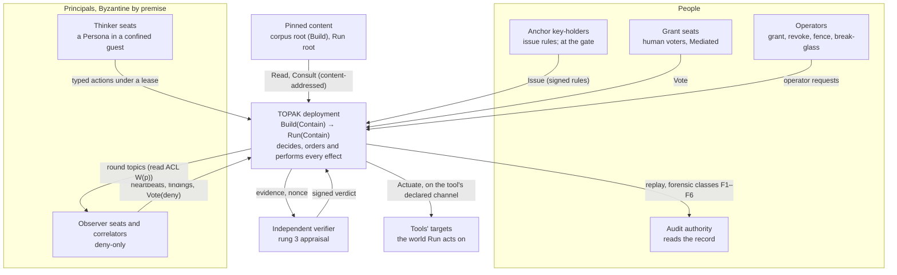
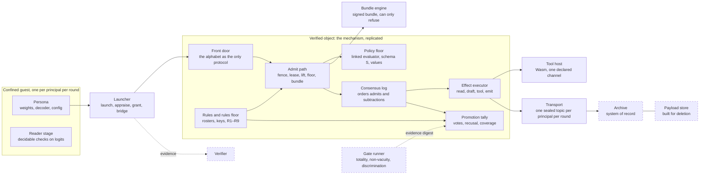
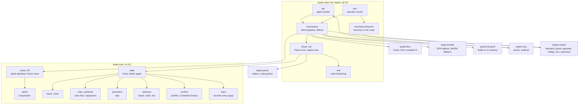
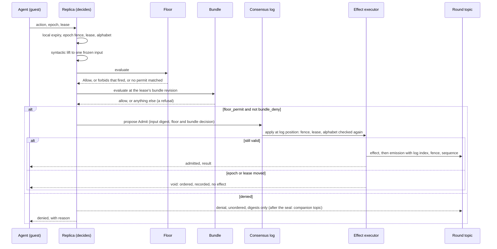
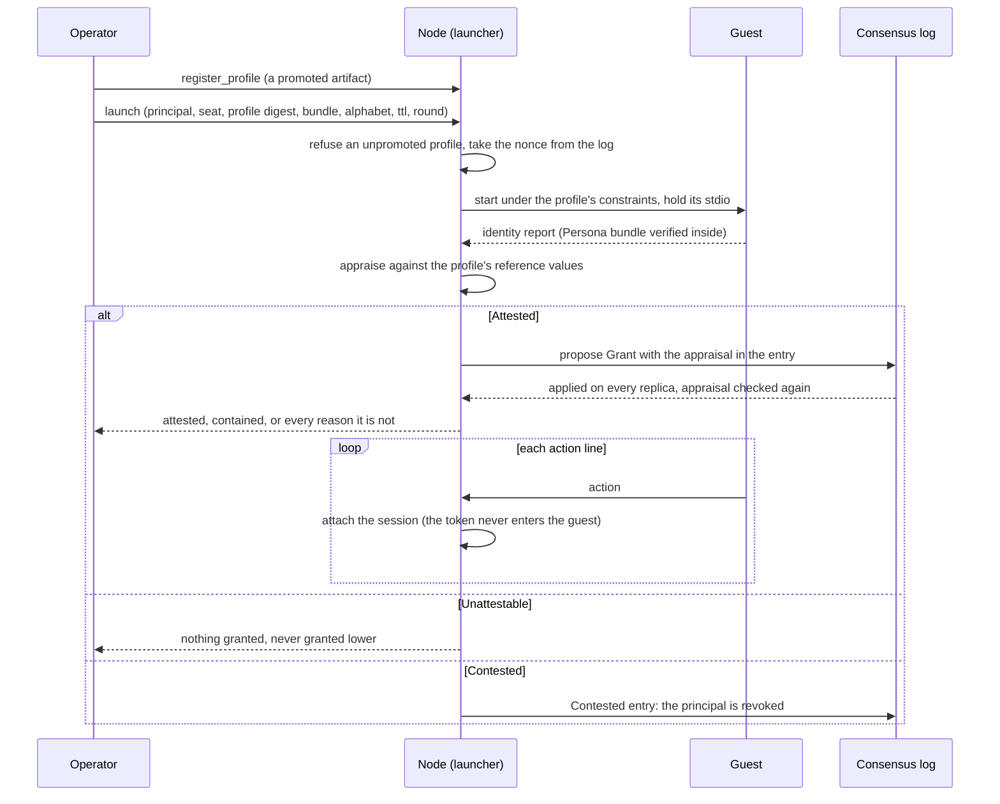
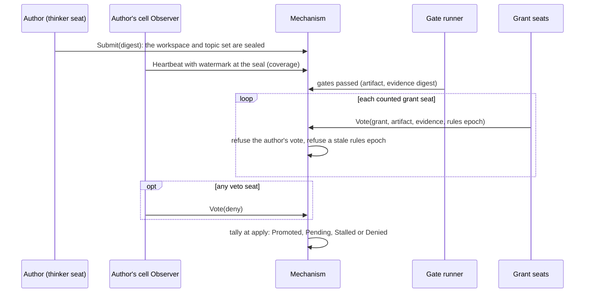
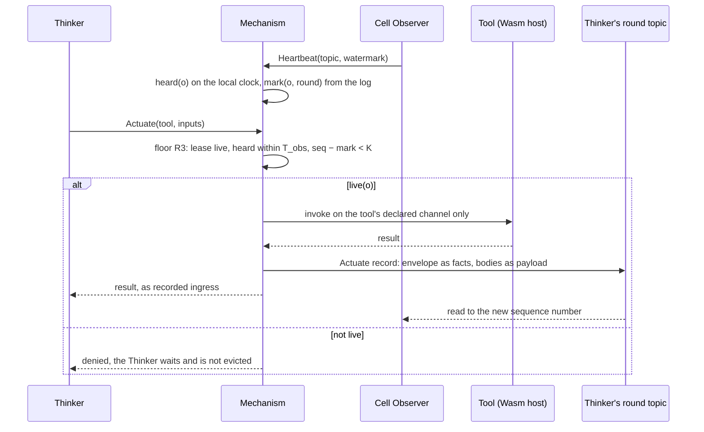
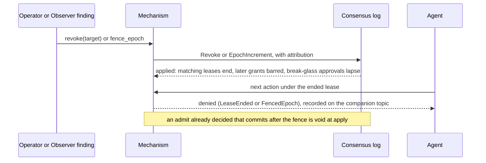
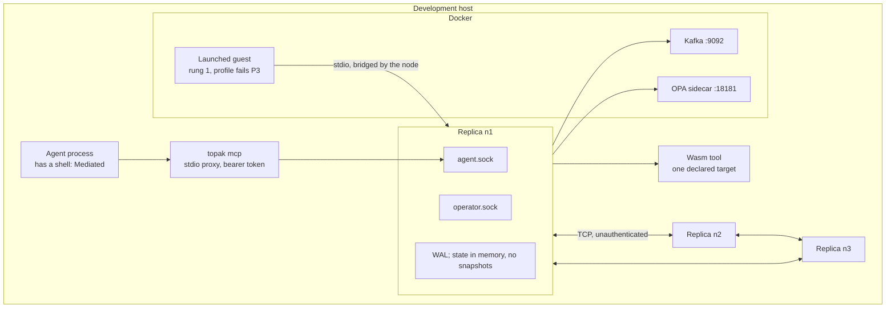

# TOPAK — Architecture Description

**2026.10.03** · revision 1 · **DRAFT, not cut with any checkpoint** · **an index, not an authority** · drawn against
Genesis Checkpoint G9 (2026.10.02) and Theory of Operation revision 13 · arc42 structure · written to conform to
ISO/IEC/IEEE 42010 (§0.6) · diagrams at C4 levels

**Drafted by the assistant** at the custodian's request, from the 2026.10.03 session that recommended this document
form. Every choice of structure, grouping and wording here is the drafter's and none is ratified. It decides
nothing: a sentence here that a record does not support is an error in this document.

---

## 0. About this document

### 0.1 Precedence

**The checkpoint wins, the records decide, the Theory of Operation argues, the diagrams depict, and this document
indexes.** Where it disagrees with any of them, it is wrong. It exists because the Theory of Operation (ToO) is
organised as an argument about why the design is safe, and so never gives a reader three things: a list of the parts,
how they interact over time, and one table tracing each guarantee to its evidence. Those are §5, §6 and §10, and they
are the only sections with new prose. Every other section is a pointer table.

| Layer | Where | Role |
|---|---|---|
| State of record | [`checkpoints/`](../checkpoints/README.md), G9 | What is ratified, owed and open |
| Decisions | [`decisions/`](../decisions/README.md), ADR-0001 onward | What was decided, and why |
| Argument | [Theory of Operation](theory-of-operation.md), revision 13 | How it fits together and why it is safe |
| Vocabulary | [Glossary](glossary.md) | What the words mean |
| Depiction | [`diagrams/`](../diagrams/README.md), A1 to H5 | Thirty-one drawings of the records |
| **Index** | **this document** | **The parts, the scenarios, the traceability** |

### 0.2 What is described

Two entities, and every view says which it shows.

- **The archetype**: the pattern at its maximum parameter values (ADR-0023). It is what the theorems are about, and
  nobody ships it (ToO §8.1).
- **The reference**: the Rust implementation of the admit path under [`mechanism/`](../mechanism/README.md). It is
  evidence, not the verified object (ADR-0033 §1), and not a deployment.

### 0.3 Stakeholders and concerns

| Id | Stakeholder | Concerns |
|---|---|---|
| S1 | **Genesis custodian** (sole, custody (1, 0); ADR-0029) | Do the layers still agree? What is owed before bootstrap? |
| S2 | **Bootstrap reviewer**, independent of the author (ADR-0029 A2; none engaged) | What must be read, in what order, and what does each claim rest on? |
| S3 | **Grant and veto seats** after bootstrap (ADR-0024) | What does a confirmation promotion confirm? What evidence does a vote bind to? |
| S4 | **Anchor key-holders** (ADR-0025) | What can an issuance change, and what bounds it? |
| S5 | **Implementer** of the reference or of a deployment's mechanism | What are the parts and interfaces? What is built, provisional or missing? |
| S6 | **Deployer and operator** | Which theorems does my configuration keep? How is authority withdrawn, and how fast? |
| S7 | **Agent developer** (a Thinker or an Observer behind the alphabet) | What can an agent do, and what happens when it is refused? |
| S8 | **Acquirer, auditor or assessor** (NIST AI RMF Playbook; TACIP discussion draft) | For each claim: mechanism, evidence, residual risk. What is not measured? |

| Concern | Stated as | Stakeholders | Answered in |
|---|---|---|---|
| K1 | What is inside the system, and what does it touch? | S2, S5, S8 | §3 |
| K2 | What are the parts and who owns each obligation? | S2, S5 | §5 |
| K3 | How does an action become an effect, and how is it refused? | S5, S7 | §6.1, §6.4 |
| K4 | How does authority enter, change and leave? | S3, S4, S6 | §6.2, §6.3, §6.5, §6.6 |
| K5 | What does a given deployment keep, and lose? | S6, S8 | §7 |
| K6 | Why should a guarantee be believed, and under what premises? | S2, S3, S8 | §10 |
| K7 | What is trusted without proof? | S2, S4, S8 | §10.3, §11 |
| K8 | What is not built, not measured or not reviewed? | all | §5.4, §11 |
| K9 | Do the specification, policy, code and records agree? | S1, S2 | §0.5 |

### 0.4 Viewpoints

Each view in this document is governed by one viewpoint. Diagrams are Mermaid, so they render on the repository
host and carry no generator; they are sketches at C4 levels and do not join the generated family in `diagrams/`.

| Viewpoint | Frames | Model kinds | Conventions | View |
|---|---|---|---|---|
| Context | K1 | C4 level 1 (system context); interface table | A box is a system or actor; an arrow is a named channel | §3 |
| Building block | K2, K8 | C4 level 2 (containers), level 3 (components); responsibility tables | Dashed border: not built at the reference | §5 |
| Runtime | K3, K4 | Sequence diagrams; step tables | A solid arrow is a request; a dashed arrow is a reply or record | §6 |
| Deployment | K5 | C4 deployment diagram; axis table | Archetype value beside the reference's value | §7 |
| Concept | K3, K4 | Pointer table | Cites the ToO section and records; restates nothing | §8 |
| Decision | all | Pointer table | Cites ADRs by id | §9 |
| Assurance | K6, K7 | Traceability matrix; trusted-base pointer | One row per guarantee group; status words are the binding table's | §10 |
| Risk | K7, K8 | Pointer table | Cites the residual-risk statement and G9 | §11 |

### 0.5 Correspondences and correspondence rules

The corpus has five layers that must agree: records, TLA+ modules, floor policy, Rust code and manifests. These are
the rules that tie them, each with the check that enforces it. They answer K9, and they are what the critical reviews
ask for while the corpus has no second reader.

| Rule | Correspondence | Enforced by |
|---|---|---|
| CR-1 | Every record and module the reference follows is pinned by digest | `mechanism/corpus-pins.sha256`; `cargo test -p topak-core --test drift` |
| CR-2 | Every checked property names its record, its module and its premises | [`spec/theorem-premise-binding.md`](../spec/theorem-premise-binding.md) and `.json`; `spec/inventory.py --check` |
| CR-3 | Every proved module is frozen by digest, and a successor carries its own proof | `spec/proof-sync.sh`; ADR-0046 |
| CR-4 | The floor the code enforces is the floor the gates checked | `topak-floor` includes `floor/*` by path and refuses to load on a digest mismatch |
| CR-5 | Every behaviour a test exercises matches the operational model, step for step | `spec/mechanism-trace-run.sh` over `spec/Mechanism.tla` (drift detection, not refinement) |
| CR-6 | Every TLA+ property the reference restates has a named Rust test | [`mechanism/GAPS-AND-ASSUMPTIONS.md`](../mechanism/GAPS-AND-ASSUMPTIONS.md) §6 |
| CR-7 | Every trusted-base row is a premise of the theorems that rest on it | ADR-0045 §3; the binding table's row premises |
| CR-8 | Every cut is measured, and every cited path resolves | `tools/verify-manifest.sh --all`; `tools/check-refs.py` |
| CR-9 | A diagram of the binding table is built from the table | `diagrams/gen-topak-family.py` (G3 fails if the table moved) |
| CR-10 | Every building block in §5 names its records, modules and code | §5.2 and §5.3 of this document; **no check enforces it** |

**Known inconsistencies.** They are recorded where they were found, not repeated here: the thirty findings of the
[format and schema inventory](../derived/topak-format-and-schema-inventory-2026.10.03.md) §11; ADR-0045 Annex B behind
the code (ToO §7.9); and the errata in [`checkpoints/README.md`](../checkpoints/README.md).

### 0.6 Conformance to ISO/IEC/IEEE 42010

Claimed by construction and assessed by nobody. Clause numbers are the 2011 edition's and were mapped from the
drafter's knowledge of the standard, not against its text; a reviewer with the standard in hand should check them,
and the 2022 edition's terms (entity of interest, aspects) are not mapped.

| 42010 requirement | Where |
|---|---|
| 5.2 Identification and overview | Header, §0.1, §0.2, §1 |
| 5.3 Stakeholders and concerns | §0.3 |
| 5.4 Viewpoints | §0.4 |
| 5.5 Views, one per viewpoint | §3, §5 to §11 |
| 5.6 Models, each of a stated kind | §0.4, column *Model kinds* |
| 5.7 Correspondences, rules and known inconsistencies | §0.5 |
| 5.8 Rationale and decisions | §4, §9; the ADRs themselves |

---

## 1. Introduction and goals

TOPAK is an architecture pattern for autonomous multi-agent collaboration that is safe by design. It treats every
agent as Byzantine, keeps models out of the trusted computing base, and states every guarantee against what an
agent's action alphabet allows (ADR-0007). The letters name roles, not products ([README](../README.md); ToO §1;
diagram A1).

**Status.** A design corpus in its genesis phase with a reference implementation of the admit path. Forty records
are Accepted (genesis), twenty-two of them awaiting independent confirmation; no reviewer other than the author has
read any of it (G9; `checkpoints/README.md`).

**Quality goals**, in priority order. §10 traces each to evidence.

| # | Goal | In one sentence | Source |
|---|---|---|---|
| Q1 | Containment | A principal reaches the world only through its typed alphabet, and safety never depends on what a model means | ADR-0007, ADR-0015, ADR-0022, ADR-0040 |
| Q2 | Monotone authority | Adding authority needs consensus; subtracting it needs no quorum; bundles, renewals and degeneracies only subtract | ToO §7.8 |
| Q3 | Bounded authority change | Authority changes only by promotion or anchor issuance, and two verified floors bound both | ADR-0024, ADR-0025, ADR-0026 |
| Q4 | Legible record | Every admitted boundary event stays readable by the audit authority for the declared horizon | ADR-0015, ADR-0020, ADR-0028 |
| Q5 | Fail-closed operation | Unavailability of any dependency stalls or denies; it never grants | ADR-0012, ADR-0027, ADR-0039 |
| Q6 | Declared variation | A deployment differs from the archetype only by named parameters, and loses named theorems | ADR-0023, ADR-0045 |

---

## 2. Constraints

| Kind | Constraint | Source |
|---|---|---|
| Assumptions of use | Fourteen, A1 to A14. A deployment that does not meet them does not inherit the theorems. The reference fails A1 | ToO §13 |
| Technical | Models are outside the trusted base; only syntactic lift enters the admit path | ADR-0007 |
| Technical | The floor evaluator needs a mechanized semantics and decidable policy comparison (Cedar at the reference; no Rego to Cedar translation) | ADR-0030 |
| Technical | Clocks buy liveness, never safety; an interval whose failure preserves authority needs trusted time | ADR-0032 |
| Technical | Replicas are crash-recovery, not Byzantine | ADR-0033 §3 |
| Technical | A component enters the trusted base only if its failure can only subtract, or its identity is issued | ADR-0045 |
| Organisational | Genesis: one custodian ratifies unilaterally; bootstrap needs a drafted specification and an independent review of the whole corpus | ADR-0029, A2 |
| Organisational | Archetype bootstrap needs no fewer than five humans | ToO §9 |
| Convention | Records change only by typed History rows; checkpoints, derived documents and results files are dated and frozen; everything is cited by digest | `decisions/README.md`; G9 §5 |
| Convention | The narrative is cut with each checkpoint | [`narrative/README.md`](README.md) |

---

## 3. Context and scope

**C4 level 1, system context, of the archetype.** The system is one deployment: two domains, `Build` and `Run`, each
wrapped by the same membrane, `Contain` (ADR-0001, ADR-0002; diagram A2).

| External interface | What crosses | Record | At the reference |
|---|---|---|---|
| Agent to mechanism | One action of nine variants (six Build, three Run), with epoch and lease | ADR-0022, ADR-0040 | MCP tools over stdio, proxied to the agent socket; inventory §4.1, §4.2 |
| Operator to mechanism | Grant, renew, end round, revoke, fence, issue, gates passed, break-glass approval, register profile, launch | ADR-0031, ADR-0033 | Operator socket; unauthenticated (PROVISIONAL); inventory §4.3 |
| Anchor to mechanism | An issuance, validated by `Authentic` and the rules floor | ADR-0025, ADR-0026 | `issue` on the operator socket; no ceremony |
| Mechanism to verifier | Evidence and a log-derived nonce; a signed verdict back | ADR-0034 | Simulated under test keys |
| Mechanism to the world | A tool invocation on its declared channel | ADR-0042, ADR-0034 A2 (pending) | Wasm tool host; a native tool is unchecked |
| Mechanism to record readers | Round topics, the log, the archive | ADR-0003, ADR-0004, ADR-0005 | Kafka topics and the log; no archive |

**Out of scope by position**: what a model means or intends; the correctness of an agent's work; effects of a
`Mediated` principal outside its alphabet. The fourteen boundaries are the
[boundary register](../derived/topak-boundary-register-2026.09.13.md) and diagram A3.

---

## 4. Solution strategy

| Goal | Approach | Records | ToO |
|---|---|---|---|
| Q1 | A typed alphabet per domain; syntactic lift only; confinement attested at grant on a four-rung ladder | ADR-0007, ADR-0022, ADR-0034, ADR-0040 | §2 |
| Q1, Q2 | `admit ⟺ floor_permit ∧ ¬bundle_deny`: a small verified floor permits, a runtime bundle can only refuse | ADR-0010, ADR-0030 | §3.1 |
| Q2 | One composite credential, the lease: round-coterminous, renewal only narrows, revocation needs no quorum | ADR-0031 | §2.5 |
| Q3 | Promotion is a quorum grant; the anchor is a havoc issuer bounded by a rules floor; intent is the sole axiom | ADR-0024 to ADR-0027 | §7 |
| Q4 | Every effect has an ordered, signed admit before it; denials are recorded; six forensic classes survive erasure | ADR-0015, ADR-0020, ADR-0028 | §4 |
| Q5 | Resident floor and rules; consensus for grants and local for denials; Observer liveness coupled to admission | ADR-0012, ADR-0027, ADR-0039 | §3.1, §5.4, §7.4 |
| Q6 | Degeneracy from a unique maximum; a trusted base declared row by row; theorems computed void, never weakened | ADR-0023, ADR-0045 | §7.9, §8 |
| All | Semantic judgment only as an Observer finding, which may subtract and never add | ADR-0007, ADR-0038 | §5 |

---

## 5. Building block view

### 5.1 Level 1: the deployment as containers (archetype)

**C4 level 2.** A dashed border marks a block the reference does not build.

### 5.2 Blocks, obligations and where each lives

Status words: **built** (runs in the reference's tests), **partial**, **simulated**, **absent**. "Proved" and
"checked" are the binding table's.

| Block | Obligation | Records | Specification | Reference | Status |
|---|---|---|---|---|---|
| Front door | Expose the alphabet and nothing else | ADR-0022, ADR-0040, ADR-0033 §2 | `Seats`, `RunSeats` | `topak-mcp`; `topak-node` agent socket | Built. The protocol, not the channel, unless launched |
| Admit path | Fence, lease and alphabet checks; one frozen input; compose floor and bundle; check again at apply | ADR-0015, ADR-0030 §1, ADR-0033 §4 | `FloorComposition`, `Lease_A1`, `Mechanism` | `topak-core` (`lift`, `admit`, `state`); `topak-node` | Built |
| Lease | One composite credential, twelve fields; grant, renew, expire, revoke | ADR-0031, ADR-0032 | `Lease`, `Lease_A1` | `topak-core` (`lease`, `clock`) | Built |
| Policy floor | Permit only what seventeen policies allow, over schema S; any error is a deny | ADR-0010, ADR-0012, ADR-0030, ADR-0041 | `FloorComposition`, `FloorRouting`; the gates in `floor/` | `topak-floor` over [`floor/`](../floor/README.md) | Built, of a **draft** floor |
| Bundle engine | Refuse unless the lease's signed revision affirmatively allows | ADR-0030, ADR-0044 | `FloorComposition` | `topak-bundle`; [`policies/`](../policies/) | Built; dev key, custody (1, 0) |
| Rules and rules floor | Hold rosters, quorum and keys; reject an issuance outside R1 to R9 | ADR-0025, ADR-0026, ADR-0027 | `RulesFloorNV_rev5`, `Anchor` | `topak-core` (`rules`, `authentic`) | Built; dev rules, no genesis rules |
| Promotion tally | Count votes bound to (artifact, evidence, rules epoch); recuse the author; require coverage | ADR-0024, ADR-0039 §3 | `RulesFloorNV_rev5`, `Observers`, `Coupling`; `Promotion` unwritten | `topak-core` (`promotion`) | Partial. No pipeline; gate evidence is an operator's assertion |
| Consensus log | Order every admit and every subtraction that changes replicated state | ADR-0033 §3, §4 | `Voting` as a ghost; `Paxos` unwritten | `topak-paxos`; `topak-node` (`driver`, `wal`, `net`) | Built; replicas unauthenticated |
| Effect executor | Perform an effect only after its admit commits; record every `Actuate` | ADR-0015, ADR-0042 | `RunCoupling` | `topak-node` (`mechanism`) | Built |
| Observer coupling | Keep `heard`, `mark`, `live(o)`; refuse a Thinker's effect without a live cell Observer | ADR-0038, ADR-0039 | `Observers`, `Coupling`, `RunCoupling` | `topak-core` (`observer`); floor entry R3 | Built. No detector behind the seat; `W(p)` not enforced |
| Launcher | Start a guest from a promoted profile, appraise, grant, bridge | ADR-0034, ADR-0036 (Proposed), ADR-0033 A7 (pending) | `Confinement`, `Confinement_A1` | `topak-contain`; `topak-node` (`mechanism::launch`) | Rung 1 built; rung 3 simulated; rung 2 a seam |
| Tool host | Give a tool its workspace or its one declared channel, and nothing else | ADR-0034 P4, A2 (pending) | `RunConfinement` | `topak-contain` (`wasmtool`); `topak-mcp` (`toolhost`) | Wasm built (provisional ABI); native tools unchecked |
| Transport | One topic per principal per round, sealed; denials unordered; an `after` companion | ADR-0003, ADR-0005 (Proposed), ADR-0020 | none | `topak-transport` | Built |
| Persona | Bind a model to its whole runtime configuration | ADR-0016 to ADR-0020 | none | [`slm/`](../slm/README.md) rehearsal only | Absent as an attested artifact |
| Lineage projection | Compute independence from the log, not from a manifest | ADR-0035 (Proposed) | none | `slm/` rehearsal | Rehearsed, not in force |
| Verifier | Appraise rung-3 evidence under an issued key | ADR-0034 | `Confinement` | `topak-contain` (`sim`) | Simulated |
| Gate runner | Run the three gates and sign the evidence | ADR-0007, ADR-0030 A1 | `FloorRouting` | `floor/run-gates.py` outside the mechanism | Partial. Evidence unsigned |
| Archive and payload store | Keep control-plane facts; keep payloads apart, deletable | ADR-0004, ADR-0005 | none | none | Absent |
| Erasure | Delete sealed topics and payloads as an ordered, modeled event | ADR-0006, ADR-0013, ADR-0028 | `NonComposition` | none | Absent; no roster at genesis |
| Anchor ceremony | Seat key-holders; sign the genesis bundle | ADR-0025, ADR-0029 | `Anchor`, `BreakGlass`; three of five modules unwritten | none | Absent |

### 5.3 Level 2: the reference's mechanism as components

**C4 level 3**, of the reference only. Eight crates in one workspace; four do no I/O. Module responsibilities below
are read from the crate table in `mechanism/README.md`, the file names and the format inventory, not from a review of
the code.

| Crate | Does | I/O | Tests that restate the specification |
|---|---|---|---|
| `topak-core` | Types, lease, rules floor, tally, lift, composition, replicated state | none | `mutations.rs`, `confinement.rs`, `drift.rs` |
| `topak-paxos` | Sans-IO crash-fault Multi-Paxos with a `Voting` ghost | none | `sim.rs` |
| `topak-floor` | Cedar engine with the gated floor and schema compiled in, pinned by digest | none | `floor.rs` |
| `topak-bundle` | OPA sidecar client; local WASM fallback bound to the lease's revision | HTTP | `fallback.rs` |
| `topak-transport` | Round topics | Kafka | none |
| `topak-mcp` | The alphabet as MCP tools; the downstream native tool host | stdio | none |
| `topak-contain` | Launcher backends, guest channel, appraisers, bridge; the Wasm Run tool host | processes, docker, the declared target | `launch.rs`, `wasmtool.rs` |
| `topak-node` | Replica: Paxos driver, WAL, admit pipeline, effects, sockets, CLI | all | `e2e.rs`, `contain.rs` |

The replicated log has eleven entry kinds (`Grant`, `Renew`, `Admit`, `EndRound`, `Revoke`, `EpochIncrement`,
`Contested`, `ProfileRegister`, `Issue`, `GatesPassed`, `BreakGlassApprove`); state is rebuilt by replaying it, and
there are no snapshots (inventory §5). Diagram H4 draws the same components with their formats.

### 5.4 What is not a block yet

The Observer as a detector, the correlator's detection function, the topic read ACL, the archive, erasure, masking,
Persona attestation, bootstrap, a promotion pipeline, replica and operator authentication, and a refinement from the
specification to the code. Each is named in ToO §15 ("What it does not show"),
[`GAPS-AND-ASSUMPTIONS.md`](../mechanism/GAPS-AND-ASSUMPTIONS.md) §3 or the
[design-gap assessment](../derived/topak-design-gap-assessment-2026.10.03.md).

---

## 6. Runtime view

Seven scenarios. Each says which entity it shows. Diagrams D1, C5, B5, E2 and D4 draw the same paths in full.

### 6.1 An action is admitted, or denied (reference)

Decide, then order, then effect (ADR-0033 §4; ToO §4.1).

- The floor and bundle are not re-run at apply; their decision is recorded with the digest of the input it covered.
- A crash between commit and effect leaves no effect.
- Guarantees exercised: `AdmitImpliesFloorPermit`, `FloorErrorIsDeny`, `BundleRefusalHonored`,
  `NoActionUnderFencedEpoch` (§10.2).

### 6.2 A guest is launched and granted a lease (reference, rung 1; ADR-0036 Proposed, ADR-0033 A7 pending)

- A grant requires that the principal holds no live lease and exactly one seat.
- A dead guest closes the pipe and the round ends; a dead launcher takes the session with it and the lease expires.
- Every real guest's profile declares P3 failing, so the verdict is `Mediated`. Rung 3 runs only under test keys.

### 6.3 An artifact is promoted (reference for the tally; archetype for the gates and seats)

- There is no promotion log entry: the admit that completes the tally is the event (inventory §1.5).
- A timeout never grants. A missing independent veto seat or missing coverage stalls (ADR-0024 A2).
- At the reference "gates passed" is an operator's assertion, the veto seat's independence is unchecked (G18), and
  there is no pipeline that signs or deploys what was promoted.

### 6.4 A Run effect, coupled to a live Observer (reference)

- `Consult` is ingress and is never coupled. A call that returns after the seal is recorded as `unknown` and its
  result withheld.
- The next round is granted only once the last was read to its seal.
- `T_obs`, `K` and `R` are placeholders. The bound holds only for an Observer whose watermark is honest.

### 6.5 Authority is withdrawn (reference)

Three tools, none needing a quorum, all ordered: a **targeted revocation** (by principal, Persona or confinement
profile), an **epoch fence** (every live round), and **expiry** (local clock, then ordered) (ADR-0031; ToO §2.5).

This is the scenario the TACIP discussion draft's implementation 3.9.5 asks to be demonstrated. Read against its
five conditions:

| 3.9.5 condition | What the design gives | What is missing |
|---|---|---|
| (a) Effective | Revocation is an ordered state change, checked at decide and at apply; `RevokedStaysStopped`, `NoActionUnderFencedEpoch` are proved and restated as tests | Holds only for effects in the alphabet. A `Mediated` principal's other channels are untouched |
| (b) Timely | Subtraction takes one consensus round and no quorum of people | **No number is declared.** `W`, `L` and `D` are unmeasured or placeholders; `T_irrev` is declared for no effect class |
| (c) Verifiable without self-attestation | Stop attribution is forensic class F2, in the log, with denied attempts on the companion topic | **No reader who is not the author** has verified any of it; the replicas are trusted |
| (d) Durable | A revocation is permanent within the rules-epoch chain; renewal cannot widen | The horizon ends at re-genesis (ToO §4.4) |
| (e) Sufficient in scope | One principal, one Persona, one profile, or the fleet | Scopes nobody can name fall back to the fleet fence |

### 6.6 Break-glass (reference for approvals; archetype for the rest)

Break-glass is an admit against a declared floor exception, not a third kind of event (ADR-0009, ADR-0013; diagram
D4). Roster keys sign approvals scoped to (seat, epoch); at the issued quorum, an `Actuate` under that seat is
admitted with the break-glass flag and recorded as forensic class F5. It reaches `Actuate` and nothing else, can
never authorize `Issue`, `Vote` or promotion (R7), and a bundle can narrow it. Approvals lapse at the next epoch
increment or on revocation of the seat. **Two stated defects**: there is no TTL (R8 is drafted and pending, and
needs trusted time), and R3 couples break-glass to Observer liveness, so the emergency path waits on a dead Observer
(ToO §5.4).

### 6.7 Erasure, issuance and floor change (archetype; not built)

- **Erasure** is a consensus-ordered admit against its exception entry, executed by deleting sealed topics and
  payload-store entries; the six forensic classes are floor denials on its envelope, and the erasure itself is F6
  (ADR-0006, ADR-0028). Genesis issues no erasure roster, so the path is disabled from epoch 0.
- **Issuance** is an environment action: authentic, epoch-incrementing and inside the rules floor, or rejected
  (ADR-0025, ADR-0026; diagram B6). The reference validates issuances; there is no ceremony.
- **A floor change** is routed by a computed comparison of the deployed and candidate floors: a tightening is a
  promotion, and anything else is an issuance and a promotion. A `holds` verdict counts only with a proof a pinned
  checker accepted (ADR-0030 §5, A1; diagram B3).

---

## 7. Deployment view

### 7.1 The reference, as run in development

**C4 deployment diagram.** One host; nothing here is a deployment in the pattern's sense.

Three replicas from `scripts/dev-init.sh`; Kafka and the OPA sidecar are optional, with an in-memory transport and
the in-process WASM bundle as the default. Diagram H4 is the full drawing.

### 7.2 The archetype against the reference, axis by axis

A deployment is a tuple of per-axis values, each below the archetype by a declared degeneracy (ADR-0023; diagram
G2). **No deployment declaration has been written**, for the reference or anything else (G9 open list); this table
is a reading of ToO §8.2 and §15, not a declaration.

| Axis | Archetype | Reference today | Declared degeneracy that names it |
|---|---|---|---|
| Confinement rung | 3: confidential VM, independent verifier | 0; 1 under the launcher's own assertion; 3 simulated | D-0034-1 to D-0034-4 |
| Persona provenance | In-house, two independent lineages | No attested Persona | D-0035-1 (Proposed) |
| Anchor custody | Unanimity, n ≥ 3: (n, 0) | Single custodian: (1, 0) | D-0025-1, D-0025-2 |
| Approver fault tolerance | `quorum = "all"`, at least two counted seats | Dev rules | D-0024-1, D-0024-2 |
| Floor verification | Proven floor on a verified evaluator, routing checked | Draft floor, gated, checker in place since 2026.10.01 | D-0030-1, D-0030-2 |
| Observer scoping | One per cell plus a correlator | Seats exist; no detector | D-0037-1, D-0038-1, D-0038-2 |
| Observer coupling | Coupled in Run; gate coupled in Build | Coupled | D-0039-1 |
| Emission retention | Raw emission retained | Not retained | D-0037-2 |
| Bundle signing | Issued key, signed at promotion | Dev key; signing is a script step | D-0044-1 |
| Tools | Wasm components, hermetic or held to one channel | Wasm modules (provisional ABI); native tools unchecked | D-0034-3, D-0034-5, D-0034-6 |
| Trusted base | Thirty-one declared rows | Annex B, behind the code | D-0045-1 |

`spec/inventory.py` computes, from a trusted-base declaration, which theorems a deployment keeps. That computation
is the deployment view's real content; the table above is only its input, read informally.

---

## 8. Crosscutting concepts

Each is argued in the ToO and decided in the records. Nothing is restated.

| Concept | ToO | Records | Diagram |
|---|---|---|---|
| The membrane: `Contain`, `Contained` and `Mediated` | §2.1 to §2.3 | ADR-0002, ADR-0007, ADR-0034 | A2 |
| Typed alphabets, bounded by seat kind | §2.4, §2.9 | ADR-0022, ADR-0037, ADR-0040 | C2 |
| The lease as the credential | §2.5 | ADR-0031 | C3 |
| Confinement rungs and profiles | §2.6, §2.7 | ADR-0034, ADR-0036 | C4, C5 |
| Principals, seats and cells | §2.8 | ADR-0037 | C1 |
| Composition of floor and bundle | §3.1 | ADR-0030, ADR-0044 | D2 |
| Floor change routing; exceptions | §3.2, §3.3 | ADR-0013, ADR-0030 | B3, D4 |
| Effects and authority changes are enumerated | §4.1 | ADR-0015, ADR-0033 §4 | B1, D1 |
| Topics, payloads, erasure, the forensic floor | §4.2 to §4.4 | ADR-0003 to ADR-0006, ADR-0020, ADR-0028 | D3, D4 |
| Observers: any-of, deny-only, coupled by progress | §5 | ADR-0021, ADR-0038, ADR-0039 | E1, E2 |
| The Persona and lineage | §6 | ADR-0016 to ADR-0020, ADR-0035 | F1 |
| Promotion, the anchor, the rules floor | §7.1 to §7.6 | ADR-0024 to ADR-0027 | B5, B6, B4 |
| Monotonicity, layer by layer | §7.8 | (fourteen layers) | A4 |
| The trusted base | §7.9 | ADR-0045, ADR-0046 | G1 |
| Degeneracy | §8 | ADR-0023 | G2 |
| The clock model and the timing budget | §10 | ADR-0032 | E2 |
| Genesis and bootstrap | §9 | ADR-0029 | B7, H1 |

---

## 9. Architecture decisions

The decisions are the records, indexed in [`decisions/README.md`](../decisions/README.md) and drawn in diagram H2.
At G9: forty Accepted (genesis), two of them in part (ADR-0022 and ADR-0042, each without its §6); twenty-two
carrying a confirmation-required marker; one superseded (ADR-0008); three Proposed (ADR-0005, ADR-0035, ADR-0036);
four amendments pending (ADR-0026 A1, ADR-0033 A7 and A8, ADR-0034 A2). ADR-0047 to ADR-0049 were drafted on
2026.10.03, after G9, and are Proposed.

| Area | Records |
|---|---|
| Domains and membrane | 0001, 0002, 0007, 0015 |
| Alphabets, seats and cells | 0022, 0037, 0040 to 0043, 0047 to 0049 |
| Policy | 0010, 0012, 0013, 0030, 0041, 0044 |
| Credential, time and confinement | 0031, 0032, 0034, 0036 |
| Record | 0003 to 0006, 0020, 0028 |
| Detection | 0021, 0038, 0039 (0008 superseded) |
| Model | 0016 to 0019, 0035 |
| Authority | 0009, 0024 to 0027 |
| Variation and trust | 0023, 0045, 0046 |
| Process and reference | 0029, 0033 |

---

## 10. Quality requirements

### 10.1 By trustworthiness characteristic

Organised by Table 2 of the NIST TACIP discussion draft (the 2026.09.28(a) copy in [`doc/`](../doc/); the draft is
not official guidance). One table then serves three uses: the quality tree, the mapping to trustworthiness
characteristics that Playbook GOVERN 1.2 asks for, and the risk-surface map of TACIP 3.8. The placement of each
goal under a characteristic is the drafter's.

| Characteristic | TOPAK's position | Goals | Where the evidence is |
|---|---|---|---|
| *Does it do the correct thing?* | | | |
| Valid | **Out of scope by premise.** The pattern makes no claim that an agent's work is right for its use. It contributes the deployment declaration: what holds for this configuration | Q6 | §7.2; none written |
| Accurate | **Out of scope.** A model is havoc; a worse model is harmless for containment and nothing here measures its outputs | none | ToO §6 |
| Bias Managed | **Out of scope**, except the monoculture rule: an Observer from a different lineage than its Thinker | none | ADR-0017, ADR-0035 (Proposed) |
| *Does it keep doing the correct thing as conditions change?* | | | |
| Reliable | The model is pinned as a Persona, so a silent substitution is an identity mismatch; bundles and rules are versioned and fenced | Q2, Q3 | §10.2 rows 1, 2, 5; Persona attestation absent |
| Robust | Every guarantee is stated for an agent that does anything its alphabet allows; stale bundles are monotone-safe | Q1, Q2 | §10.2 rows 2, 3 |
| Resilient | Fail-closed: resident floor and rules, local denials, a stalled Thinker in place of an unwatched one; the cost is availability | Q5 | §10.2 rows 1, 8; ToO §5.4 |
| *Does it avoid unintentional or deliberate harm?* | | | |
| Safe | Effects are exactly the admitted actions, if effect exclusivity holds; an effect irreversible on emission must not be in the alphabet | Q1 | §10.2 rows 3, 4, 6; **void at the reference** for confinement |
| Secure | Byzantine agents at every position; authority only by promotion or issuance; two floors bound both; privileged paths do not compose | Q1, Q3 | §10.2 rows 2, 5, 6, 7 |
| *Does it allow its behavior to be observed, understood and accounted for?* | | | |
| Transparent | Every admit is ordered and recorded, denials included; replay reconstructs what crossed the membrane | Q4 | §10.2 row 9; no archive |
| Explainable and Interpretable | **Narrow by decision.** A floor deny names its reason; decode observability is limited to conformance and substitution detection | Q4 | ADR-0019, ADR-0030 |
| Accountable | The audit chain runs from an effect to the intent axiom; every subtraction is attributed; six forensic classes survive erasure | Q3, Q4 | §10.2 rows 5, 9 |
| *Does it meet its obligations to those who depend on it?* | | | |
| Privacy-Enhanced | Payloads are kept apart from control-plane facts; the topic is the unit of erasure; erasure is modeled | Q4 | ADR-0003, ADR-0004, ADR-0006; **not built** |
| Fair | **Out of scope** | none | |

### 10.2 Traceability: guarantee to evidence

One row per group of guarantees. The full table, one row per property with its premises, is
[`spec/theorem-premise-binding.md`](../spec/theorem-premise-binding.md), and it governs; the test names are in
`GAPS-AND-ASSUMPTIONS.md` §6. *Proved* means the invariant is proved of the TLA+ module by TLAPS under named
hypotheses; it is not a claim about the running code. Every row also rests on the shared premises in §10.3.

| # | Guarantee | Record | Module (all proved) | Floor or mechanism | Reference tests | At the reference |
|---|---|---|---|---|---|---|
| 1 | **Lease**: renewal only narrows; no action under a fenced epoch; rung 0 is never `Contained`; revoked stays stopped | ADR-0031, A1 | `Lease_A1` | Mechanism checks, at decide and apply | `mutations.rs` | Holds |
| 2 | **Composition**: an admit implies a floor permit; a floor error is a deny; a bundle refusal is honored; a bundle cannot write a floor input | ADR-0030 §1, §4 | `FloorComposition` | The linked evaluator and schema S | `floor.rs`, `fallback.rs`, e2e | Holds, of the draft floor |
| 3 | **Floor change**: no widening without an issuance; the floor is never vacuous | ADR-0030 §5, A1 | `FloorRouting` | The gates in `floor/`, with checked proofs | Gate results 2026.10.01 | Holds since 2026.10.01 |
| 4 | **Confinement**: `Contained` means confined; no silent downgrade; a contested principal is stopped; appraisals are fresh | ADR-0034, ADR-0031 A1 | `Confinement`, `Confinement_A1` | Appraisal at grant, checked again at apply | `confinement.rs`, `contain.rs`, `launch.rs` | **Void** for `ContainedMeansConfined` and `ContestedStopped`; the others hold at rung 1 or per seat |
| 5 | **Promotion and the rules floor**: unanimity; two counted seats; the author not counted; the anchor not an approver; no solo grant; the floor preserved across issuances | ADR-0024, ADR-0026, ADR-0029 §5 | `RulesFloorNV_rev5`, `Anchor` | Rules-floor entries R1, R2, R5, R9; tally constants | `mutations.rs`, e2e | Holds, at dev rules |
| 6 | **Privileged paths**: break-glass never changes authority; break-glass and erasure do not compose into an unattributable effect or remove a forensic record | ADR-0013, ADR-0026 R7, ADR-0028 | `BreakGlass`, `NonComposition` | Floor exceptions and forensic classes F1 to F6 | `mutations.rs` | Holds; erasure unbuilt |
| 7 | **Seats**: only thinker seats author or actuate; one seat per principal; no variant name crosses domains | ADR-0037, ADR-0040, ADR-0043 | `Seats`, `RunSeats` | Floor forbids B10 and B6; the grant path | `mutations.rs`, `floor.rs` (47 cases) | Holds |
| 8 | **Detection**: denial by any-of; no effect without a live Observer; unread effects bounded by `K`; `Consult` and the correlator never gate; the seal counts effects | ADR-0038, ADR-0039, ADR-0041, ADR-0042 | `Observers`, `Coupling`, `RunCoupling` | Floor entry R3; `live(o)` | e2e, `mutations.rs` | Holds modulo an honest watermark; placeholder values; reach **declared, not enforced** |
| 9 | **Record**: every effect has an ordered, authorizing admit; denials are recorded; an `Actuate` leaves a record | ADR-0015, ADR-0020, ADR-0042 §3 | **None.** Not modeled in TLA+ | The admit path and executor | e2e | Tested, not proved |
| 10 | **Run channel fidelity**: every effect under a contained Run lease reaches its tool's declared target | ADR-0034 A2 (pending) | `RunConfinement` | The Wasm tool host | `wasmtool.rs` | Pending; Wasm tools only |
| 11 | **Consensus**: one value per ballot; the chosen value is unique | ADR-0033 §2 | **None.** `Voting` as a ghost in simulation; `Paxos` unwritten | `topak-paxos` | `sim.rs` | Holds of the simulation |

**What a quality scenario would add, and does not yet.** arc42 asks for scenarios with a stimulus, a response and a
measure. Every measure here is missing: `W`, `L`, `D`, `T_irrev`, `T_obs`, `K`, `R`, `T_persona` and the lineage
thresholds are unmeasured or placeholders (residual-risk statement §4, §5). The rows above say what is guaranteed,
not how fast or how often.

### 10.3 What every row rests on

Five trusted-base rows are premises of every guarantee (the binding table's BASE): the replicas apply the log as
crash-fault machines (T-0045-1); the records are the ones ratified (T-0045-11); **the running code refines the
checked specification (T-0045-28), for which no refinement exists**; the model checker or the prover (T-0045-29,
T-0045-31); and the build toolchain (T-0045-30). The thirty-one rows are ADR-0045 Annex A and diagram G1; what
stands when each fails is the [residual-risk statement](../derived/topak-residual-risk-statement-2026.10.03.md) §2.

---

## 11. Risks and technical debt

| What | Where it is kept |
|---|---|
| The residual risks, in order: anchor capture first, then assumed effect exclusivity, collusion, the operator at rung 1, no independent review, the gap between what runs and what is proved | [Residual-risk statement](../derived/topak-residual-risk-statement-2026.10.03.md) §1 |
| The sixteen places the argument is thin | ToO §12 |
| The genesis debt ledger and the open list | G9 §4, §7 |
| Whether a bootstrap reviewer is engaged (none), and the last review pass (none) | `checkpoints/README.md` |
| Design gaps, apart from build gaps | [Design-gap assessment](../derived/topak-design-gap-assessment-2026.10.03.md) |
| The reference's forty-two assumptions and eighteen gaps | [`GAPS-AND-ASSUMPTIONS.md`](../mechanism/GAPS-AND-ASSUMPTIONS.md) |
| Where the layers disagree | Format and schema inventory §11 |
| Gaps against the NIST Playbook | [Playbook delta inventory](../derived/topak-playbook-delta-inventory-2026.10.03.md) |
| Findings of the current review | [Critical review 2026.10.02](../derived/topak-critical-review-2026.10.02.md) |

**Risks this document adds.**

- **A fourth authority.** A document that restates the records will drift from them. The mitigation is §0.1 and
  keeping new prose to §5, §6 and §10; nothing checks it.
- **Unverified component detail.** §5.3 was not written from a code review.
- **Unchecked diagrams.** The Mermaid sketches are outside the generated family and its overlap and table checks.
- **No assurance case.** The session that proposed this document rated a structured assurance case (claim, argument,
  evidence) as co-equal with it for what the Playbook and TACIP ask. §10.2 is the evidence base one would be built
  on, and it is not one.
- **No document form satisfies either framework.** Both return to an independent reader (Playbook MEASURE 1.3;
  TACIP 3.9.5 (c)), and there is none.

---

## 12. Glossary

The vocabulary is [`glossary.md`](glossary.md). Terms this document adds, none of them the corpus's:

| Term | Meaning here |
|---|---|
| arc42 | The twelve-section template this document follows |
| C4 | A diagram convention with four levels: context, container, component, code. Levels 1 to 3 are used |
| Building block | arc42's word for a part at any level; here a role-level part of the mechanism or its surroundings |
| View, viewpoint, concern, correspondence | As in ISO/IEC/IEEE 42010 (§0.3 to §0.5) |
| TACIP | NIST's AI RMF profile for trustworthy AI in critical infrastructure, a discussion draft |

---

## Appendix A. Changes

**Revision 1 (2026.10.03).** First draft. Not cut with a checkpoint, not measured by any manifest, not tagged.

## Appendix B. Open for the custodian

1. Whether this document joins the living layer, and so is cut, tagged and measured with the ToO at the next
   checkpoint, or stays a draft.
2. Whether it takes a line in the precedence order (§0.1), which today names only the checkpoint and the narrative.
3. Whether §5 and §6 should instead be generated diagrams in the `diagrams/` family, with this document citing them.
4. Whether §10.1's placement of goals under TACIP's characteristics is the mapping GOVERN 1.2 wants, and whether it
   should follow the draft as it revises.
5. Whether §7.2 should be replaced by the reference's first written deployment declaration.
